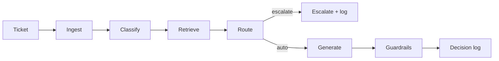

# CloudServe Assistant

Production **support triage / assist** service for CloudServe Solutions — not a free-form chatbot. One LangGraph pipeline powers the FastAPI service and the offline evaluation harness.

| | |
|--|--|
| **Source** | https://github.com/learningsam20/cloudserve-assist/ |
| **Product** | Classify → retrieve → route in code → optional generate → guardrails → decision log |
| **Threshold** | `CONFIDENCE_THRESHOLD=0.35` (measured and frozen — findings D3) |
| **Repo root** | This tree is the service root (GitHub clone, or `04_Source_Code/` from the release zip) |
| **Datasets** | In-tree `./datasets` via `DATASETS_PATH=./datasets` (relative to this service root) |

---

## Key steps (clean machine → demo)

**From GitHub:**

```bash
git clone https://github.com/learningsam20/cloudserve-assist.git
cd cloudserve-assist
```

**Or from the Capstone release zip:** `cd 04_Source_Code` (same layout as this repo root).

```bash
python3.11 -m venv .venv && source .venv/bin/activate
pip install -U pip && pip install -r requirements.txt

cp -n .env.example .env
# Edit .env — see Configuration below (and full key list in .env.example)
# Route-only / tests: leave keys as your_key_here
# Generate-on: set GROQ_API_KEY or OPENROUTER_API_KEY and matching LITELLM_MODEL

./scripts/setup_all.sh          # 1) train classifier  2) build Chroma + lexical index
./scripts/status.sh             # expect chroma count 59, classifier present
./scripts/run_tests.sh          # A1–A12 behaviour matrix
./scripts/run_eval.sh validation
# Results land in evaluation/results/<tag>_<UTC>/  (metrics.json + metrics.md + results.jsonl)

./scripts/start_api.sh
curl -s localhost:8000/health
./scripts/stop_api.sh
```

**Optional (demo / video):**

```bash
./scripts/run_hybrid_eval.sh validation   # RETRIEVAL_MODE=hybrid + Grafana export
./scripts/start_api.sh
./scripts/grafana_up.sh && ./scripts/grafana_load_dashboards.sh
# Grafana http://127.0.0.1:3000  (admin / cloudserve)
```

**Order matters:** `setup_all.sh` before pytest / eval / API, or index-backed paths skip/fail.

### Configuration (`.env`)

Copy [`.env.example`](.env.example) → `.env`. All product knobs are env-only (`src/config.py`); there are no silent code defaults.

| Knob | Shipped value | Notes |
|------|---------------|--------|
| `DATASETS_PATH` | `./datasets` | Vendored Pack tickets/docs (relative to this tree) |
| `CONFIDENCE_THRESHOLD` | `0.35` | Frozen (findings D3); Pack `0.80` was illustrative |
| `RETRIEVAL_MODE` | `auto` | `dense` / `hybrid` / `auto` (dense first, hybrid if weak) |
| `KILL_SWITCH` | `false` | Or use `./scripts/kill_on.sh` (file + env; findings D4) |
| `USE_EVAL_LABELS` | `true` | Honour `must_not_auto_respond` labels when present |
| `OPENROUTER_API_KEY` / `MODEL_NAME` / `LITELLM_MODEL` / `LITELLM_API_BASE` | OpenRouter free-router defaults | Needed only for live generate |
| `GROQ_API_KEY` (+ switch model lines) | placeholder | Recorded FCR used Groq — uncomment/switch block in `.env.example` |
| `LLM_*` | temp 0.1, timeout 30, retries 6, min interval 4s | A11 resilience / rate limit |

Full list (Chroma, classifier paths, hybrid floors, eval targets, train/tune bounds): [`.env.example`](.env.example). Spec notes: [`docs/design/spec/stack-and-env.md`](docs/design/spec/stack-and-env.md).

### CI (GitHub Actions on push / PR)

Workflow [`.github/workflows/ci.yml`](.github/workflows/ci.yml) mirrors the same scripts:

`setup_all.sh` → `status.sh` → `run_tests.sh` → `run_eval.sh validation`

Uses in-tree `./datasets`. Eval metrics upload as a workflow artifact.

---

## Key modules (`src/`)

| Module | Role |
|--------|------|
| `config.py` | All knobs from `.env` (no silent defaults) |
| `models.py` | Ticket / Classification / Passage / Route / PipelineResult |
| `ingest.py` | Channel normalisation |
| `classify.py` | **Rules first**, then trained sklearn (no LLM labelling) |
| `retrieve.py` | Chroma dense + optional hybrid TF-IDF RRF; `auto` fallback |
| `route.py` | Threshold, grounded override, must_not, kill switch |
| `generate.py` | LiteLLM → OpenRouter/Groq **only** on `auto_respond` |
| `guardrails.py` | Blocking checks (citation / PII / …) |
| `graph.py` | LangGraph: ingest→classify→retrieve→route→(generate)→validate→log |
| `logging_store.py` | SQLite decision audit |
| `api.py` | FastAPI `/health`, `/metrics`, `/tickets/process` |
| `observability.py` | Prometheus counters / histograms |

| Path | Role |
|------|------|
| `evaluation/harness.py` | Unattended batch (`--input` / `--output`) |
| `evaluation/metrics_report.py` | `metrics.json` / `metrics.md` |
| `scripts/train_classifier.py` | Fit intent/urgency pipelines → `storage/models/` |
| `scripts/build_index.py` | Chroma + `lexical_index.joblib` |
| `prompts/generate_v1.md` | Generation prompt (`PROMPT_VERSION`) |
| `tests/` | acceptance criteria A1–A12 matrix only |

---

## Tech stack

| Layer | Choice |
|-------|--------|
| Language | Python **3.11** (recommended) |
| Orchestration | **LangGraph** `StateGraph` |
| Classify | rules + **scikit-learn** / joblib |
| Retrieve | **sentence-transformers** + **Chroma** (`cloudserve_docs`, 59 chunks); hybrid optional |
| Generate | **LiteLLM** → OpenRouter or Groq (`LITELLM_MODEL` prefix) |
| API | **FastAPI** / uvicorn / pydantic v2 |
| Audit | **SQLAlchemy** → SQLite |
| Metrics | **prometheus-client** `/metrics` + harness JSON; optional Grafana |
| Config | **python-dotenv** (`.env` only) |

Pins: Pack `06_Configuration` exact pins do not install — resolvable set + log in `docs/plan/requirements-pin-log.md`. Additive pin: `litellm`. Findings D1–D5: `docs/plan/findings.md`.



More diagrams: [`docs/design/architecture/data-flow.md`](docs/design/architecture/data-flow.md).

---

## Where results & metrics are stored

| Artifact | Location | Committed? |
|----------|----------|------------|
| Harness metrics (primary) | `evaluation/results/<run>/metrics.json` + `metrics.md` | **Yes** (curated runs) |
| Per-ticket records | `evaluation/results/<run>/results.jsonl` | **Yes** (curated runs) |
| Run summary | `evaluation/results/<run>/run_summary.json` | **Yes** |
| Retrieval mode tag | `evaluation/results/<run>/retrieval_mode.txt` | **Yes** (hybrid comparison) |
| Decision export | `evaluation/results/<run>/decisions_export.jsonl` | No (regenerate; can be large) |
| Live Prometheus | `GET /metrics` while API runs | Runtime only |
| Grafana gauges | `observability/prometheus/textfile/*.prom` | Seeded dense/hybrid `.prom` |
| Narrative history | `docs/plan/eval-runs.md` | Yes |
| Threshold freeze | `docs/plan/threshold-freeze.md` (+ local `storage/reports/`) | Doc yes; `storage/` no |

**Curated snapshots in this repo**

| Directory | What it proves |
|-----------|----------------|
| `evaluation/results/validation_fairness_fix/` | Dense baseline route-only (route-auto **82.5%**, fairness 0pp) |
| `evaluation/results/validation_20261122T131433Z/` | Generate-on (Groq) — **FCR 82.5%**, fairness 0pp, citations 1.0 |
| `evaluation/results/validation_hybrid_20261122T101209Z/` | Forced hybrid comparison (same route rates; more passages) |

New runs: `./scripts/run_eval.sh validation` writes a fresh `evaluation/results/validation_<UTC>/`. Keep curated folders; prune one-off smoke dirs before commit if huge.

**Metrics note:** On `--no-generate` runs, use `route_auto_respond_pct` (automation rate). Customer FCR is claimed only when `fcr_claim_allowed=true` (generate-on).

### Headline metrics (labelled validation, n=80, `--no-generate`)

| Metric | Dense | Hybrid |
|--------|------:|-------:|
| Route auto-respond % | 82.5 | 82.5 |
| Escalation % | 17.5 | 17.5 |
| Classification accuracy | 0.9875 | 0.9875 |
| Route agreement vs `expected_route` | 0.775 | 0.775 |
| Mean passages / ticket | 4.33 | 4.92 |
| Fairness gap (tier / fluency, expected_auto quality) | **0 pp** | (same classifier/route) |

Re-export Grafana textfiles after a new curated run:

```bash
python -m scripts.export_eval_metrics --results-dir evaluation/results/validation_fairness_fix --retrieval-mode dense
python -m scripts.export_eval_metrics --results-dir evaluation/results/validation_hybrid_<stamp> --retrieval-mode hybrid
```

---

## Ops scripts

| Script | Purpose |
|--------|---------|
| `./scripts/setup_all.sh` | Train classifier + build retrieval index |
| `./scripts/start_api.sh` / `stop_api.sh` | Background API |
| `./scripts/status.sh` | Classifier / chroma / kill / health |
| `./scripts/run_eval.sh [validation\|development\|path]` | Harness (default `--no-generate`) |
| `./scripts/run_hybrid_eval.sh` | `RETRIEVAL_MODE=hybrid` + `.prom` export |
| `./scripts/tune_threshold.sh` | Threshold sweep |
| `./scripts/run_tests.sh` | `pytest tests/ -v` |
| `./scripts/kill_on.sh` / `kill_off.sh` | Kill-switch file |
| `./scripts/grafana_up.sh` / `down` / `load_dashboards.sh` | Optional Grafana |
| `./scripts/package_submission.sh` | Assemble release zip layout under `./_package/` |
| `./scripts/export_eval_metrics.py` | `metrics.json` → Prometheus textfile |

```bash
./scripts/run_eval.sh validation
GENERATE=1 ./scripts/run_eval.sh validation      # needs GROQ_API_KEY or OPENROUTER_API_KEY
LIMIT=50 ./scripts/run_eval.sh development
USE_EVAL_LABELS=false ./scripts/run_eval.sh validation
./scripts/run_hybrid_eval.sh validation
```

### Retrieval modes (`.env`)

| `RETRIEVAL_MODE` | Behaviour |
|------------------|-----------|
| `dense` | Chroma only |
| `hybrid` | Dense + lexical TF-IDF (RRF) |
| `auto` (default) | Dense first; hybrid **only** if top dense score &lt; `HYBRID_DENSE_SCORE_FLOOR` |

### Optional Grafana

```bash
./scripts/start_api.sh
./scripts/grafana_up.sh && ./scripts/grafana_load_dashboards.sh
./scripts/grafana_seed_live.sh    # required for Live ops pies / timeseries
# Dashboards: Live ops · Eval dense vs hybrid · Generate-on FCR
# http://127.0.0.1:3000  admin / cloudserve
```

Details: [`observability/README.md`](observability/README.md).

---

## API

```bash
./scripts/start_api.sh
# GET  /health
# GET  /metrics
# POST /tickets/process  {"ticket": { ... }, "allow_generate": false}
./scripts/stop_api.sh
```

OpenAPI: `http://127.0.0.1:8000/docs`  
Postman (optional): `docs/postman/CloudServe_Assistant.postman_collection.json`

---

## Kill switch

`KILL_SWITCH=true` in `.env` **or** `./scripts/kill_on.sh`. Semantics: findings D4 / `docs/governance/kill-switch.md`.

---

## Docs map

| Path | Contents |
|------|----------|
| `docs/plan/` | Findings, gaps, eval-runs, verification, pin log, work-log, sprint/epics |
| `docs/design/architecture/` | Spine, design, data-flow diagrams |
| `docs/design/spec/` | SPEC, stack-and-env, acceptance |
| `docs/report/` | CloudServe report (PDF) |
| `docs/workbooks/` | Stage 1–5 + Effort Log |
| `docs/video/` | Demonstration recording ([demo.mp4](docs/video/demo.mp4)) |
| `docs/governance/` | Risk, fairness, incident, kill-switch |
| `docs/postman/` | Optional API collection |

Index: [`docs/README.md`](docs/README.md).

Package (writes outside this tree by default if you set `PACKAGE_OUT`):  
`PACKAGE_OUT=../_package ./scripts/package_submission.sh` → `../_package/CloudServe_Assistant_Release/` (+ zip).
