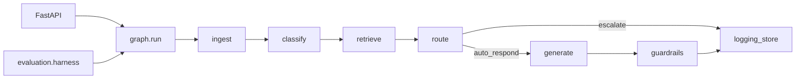

# Architecture Spine — cloudserve-support

## Design Paradigm

**Pipes-and-filters** on a single LangGraph `StateGraph`: each stage is a filter module; the graph is the only orchestrator. FastAPI and `evaluation.harness` call the same `run_ticket(state) → state` entrypoint.



## Invariants & Rules

### AD-1 — Shared graph entrypoint [ADOPTED]

- **Binds:** CAP-8, CAP-9, all pipeline CAPs
- **Prevents:** API behaviour diverging from harness metrics
- **Rule:** Only `src.graph.run_ticket` (or equivalent) executes the pipeline; API and harness must not reimplement stages inline.

### AD-2 — Dependency direction [ADOPTED]

- **Binds:** all `src/*` modules
- **Prevents:** circular imports; stages calling HTTP/Prometheus directly in a way harness cannot share
- **Rule:** `api` → `graph` → stage modules → `models`/`config`/`logging_store`. Stages must not import `api`. Metrics may be observed via thin hooks in `graph` or `metrics.py`.

```mermaid
flowchart TB
  api[api] --> graph[graph]
  harness[evaluation.harness] --> graph
  graph --> ingest
  graph --> classify
  graph --> retrieve
  graph --> route
  graph --> generate
  graph --> guardrails
  graph --> logging_store
  ingest --> models
  classify --> models
  retrieve --> models
  route --> models
  generate --> models
  guardrails --> models
  logging_store --> models
  generate --> cache
  classify -.->|no| generate
  route -.->|no| generate
```

### AD-3 — Rules+trained classifier, code route, LiteLLM generate [ADOPTED]

- **Binds:** CAP-2, CAP-4, CAP-5
- **Prevents:** LLM non-determinism in routing; free-tier burn on classify
- **Rule:** Apply deterministic classification rules first; then a sklearn classifier trained on development labels (joblib artifact). Low confidence → escalate (never LLM-as-classifier). Route is a pure function of scores + frozen threshold + policy flags + kill switch. Remote generation only via LiteLLM (OpenRouter or Groq, selected by `LITELLM_MODEL` prefix) when route is auto_respond.

### AD-10 — LiteLLM provider seam [ADOPTED]

- **Binds:** CAP-5, CAP-11
- **Prevents:** hard-wiring OpenAI client calls across modules
- **Rule:** All remote chat completions go through `src/llm.py` (LiteLLM). Provider inferred from `LITELLM_MODEL` (`openrouter/…` or `groq/…`); keys `OPENROUTER_API_KEY` / `GROQ_API_KEY`; optional `LITELLM_API_BASE`.

### AD-11 — Kill switch semantics [ADOPTED]

- **Binds:** CAP-9, FR-8, findings D4
- **Prevents:** ambiguous in-flight behaviour
- **Rule:** Env flag or kill file; checked at route; never auto_respond while on; in-flight generate may finish but send forced to escalate; harness continues escalate-only.

### AD-4 — Shared domain models [ADOPTED]

- **Binds:** CAP-1–CAP-7
- **Prevents:** ad-hoc dict shapes between stages
- **Rule:** Pydantic models in `src/models.py` (or `src/models/`) for Ticket, Passage, Classification, RouteDecision, GenerationResult, GuardrailResult, PipelineResult. Stages accept/return these types.

### AD-5 — Decision persistence + export [ADOPTED]

- **Binds:** CAP-7, A8
- **Prevents:** incomplete audit; unreproducible submission evidence
- **Rule:** Every stage decision written through `logging_store` (SQLAlchemy → SQLite). Harness/export can dump to `evaluation/results/` for submission. Coverage count must equal tickets processed for required stages.

### AD-6 — Generation cache [ADOPTED]

- **Binds:** CAP-5, CAP-8, CAP-11, NFR-07
- **Prevents:** free-tier exhaustion on repeated eval
- **Rule:** Cache remote generation by `(model_name, prompt_hash)`; honor 429/`Retry-After`; escalate-before-generate when route ≠ auto_respond.

### AD-7 — Kill switch without redeploy [ADOPTED]

- **Binds:** CAP-9, FR-8
- **Prevents:** needing a restart to stop auto-answers
- **Rule:** Kill switch is a runtime flag (env or watched file) read per ticket; when on, force escalate (document in-flight policy in README).

### AD-8 — Corpus id field [ADOPTED]

- **Binds:** CAP-3, CAP-5, CAP-6, findings D2
- **Prevents:** broken Chroma metadata / fake citations
- **Rule:** Always use `doc_id` from documentation JSON; never Setup Guide `id`.

### AD-9 — Threshold freeze [ADOPTED]

- **Binds:** CAP-4, findings D3
- **Prevents:** drifting A5 / invalidated eval
- **Rule:** `CONFIDENCE_THRESHOLD` starts at 0.80; measure on development data; freeze before recorded eval; log `threshold_applied` on every route decision.

## Consistency Conventions

| Concern | Convention |
| --- | --- |
| Naming | Modules match Setup Guide verbs: `ingest`, `classify`, `retrieve`, `route`, `generate`, `guardrails`, `logging_store`, `api` |
| IDs | Ticket: `ticket_id` str; corpus: `doc_id` str; decisions: UUID `decision_id` |
| Time | ISO-8601 UTC in logs; latency seconds float in metrics |
| Errors | Stages return structured failure → escalate/log; never bare raise out of harness loop |
| Config | `python-dotenv` + fail-loud missing provider key when generate path used (`OPENROUTER_API_KEY` or `GROQ_API_KEY`) |
| Channels | Enum: `email` \| `chat` \| `docs_comment` \| `forum` |

## Stack

| Name | Version / pin source |
| --- | --- |
| Python | ≥3.10 (CI 3.11) |
| langchain / langgraph / langchain-* | CloudServe `requirements.txt` pins |
| chromadb | CloudServe pin |
| sentence-transformers (`all-MiniLM-L6-v2`) | CloudServe pin |
| fastapi / uvicorn / pydantic | CloudServe pins |
| sqlalchemy / sqlite | CloudServe pin (`DATABASE_URL`) |
| prometheus-client | CloudServe pin |
| pytest / pytest-asyncio | CloudServe pins |
| pandas / numpy / scikit-learn | CloudServe pins (discovery, metrics, **trained classifier**) |
| litellm | **Additive** — generation via OpenRouter or Groq; swap via `LITELLM_MODEL` |
| Grafana / Prometheus | `observability/` Docker Compose — API `/metrics`, eval exporter, Generate-on FCR boards |

No framework swaps. Only approved additive beyond `06_Configuration`: `litellm`. Classifier uses pack sklearn.

## Structural Seed

```text
submission/
  README.md
  requirements.txt
  .env.example
  .gitignore
  src/
    config.py
    models.py
    ingest.py
    classify.py
    retrieve.py
    route.py
    generate.py
    guardrails.py
    logging_store.py
    cache.py
    metrics.py
    graph.py
    api.py
  prompts/
  evaluation/
    harness.py
    metrics_report.py
  scripts/
    discovery_stats.py
    tune_threshold.py
  tests/
  docs/
  data/                 # tiny fixtures only
  storage/              # gitignored runtime
  .github/workflows/ci.yml
```

## Capability → Architecture Map

| Capability | Lives in | Governed by |
| --- | --- | --- |
| CAP-1 Ingest | `src/ingest.py` | AD-2, AD-4 |
| CAP-2 Classify | `src/classify.py` + `scripts/train_classifier.py` | AD-3 |
| CAP-3 Retrieve | `src/retrieve.py` + chroma | AD-8 |
| CAP-4 Route | `src/route.py` | AD-3, AD-9 |
| CAP-5 Generate | `src/generate.py` + prompts | AD-3, AD-6 |
| CAP-6 Guardrails | `src/guardrails.py` | AD-8 |
| CAP-7 Decision log | `src/logging_store.py` | AD-5 |
| CAP-8 Harness | `evaluation/harness.py` | AD-1, AD-6 |
| CAP-9 API + kill switch | `src/api.py` | AD-1, AD-7 |
| CAP-10 Discovery scripts | `scripts/discovery_stats.py` | conventions |
| CAP-11 Resilience | `graph` + `generate`/`cache` | AD-6 |
| CAP-12 Tests | `tests/` + GHA | AD-1 |

## Deferred

- Classifier feature recipe (TF-IDF vs embedding features) — choose in Story 2.2 with measured precision.
- OpenRouter confirmed as default generate provider via LiteLLM.
- Grafana dashboard JSON — optional for demo; Prometheus scrape is enough for NFR observability seed.
- Hybrid BM25+dense retrieval — optional if dense-only fails measured retrieval quality.
- In-flight kill-switch ticket policy wording — open question.
