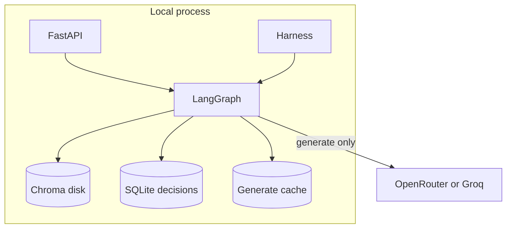
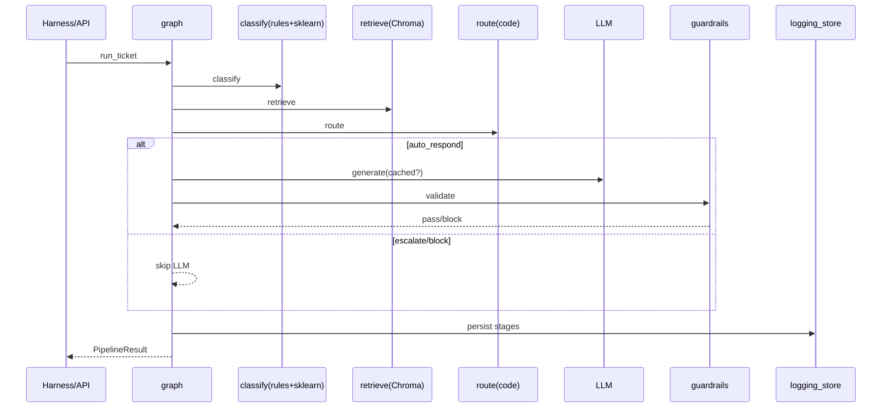

# Architecture design — CloudServe Support Assist

Builder-facing map of functional and non-functional requirements onto packages. Framework stack stays product brief; classification is a **trained local sklearn model** (plus rules). Only approved additive package is **litellm**. Spine invariants: `ARCHITECTURE-SPINE.md`.

## 1. Runtime topology

| Process | Role | Packages |
|---------|------|----------|
| `uvicorn` → `src.api` | Interactive ticket API, kill switch, `/metrics` | fastapi, uvicorn, prometheus-client |
| `python -m evaluation.harness` | Unattended batch + metrics report | same graph + pandas/sklearn as needed |
| Local models in-process | Embeddings + trained classifier | sentence-transformers, chromadb, scikit-learn/joblib |
| Remote LLM HTTPS | Generate only | **litellm** → OpenRouter (classify/route never call the LLM) |
| SQLite file | Decision log | SQLAlchemy |

## 2. Package → responsibility

| Package / pin family | Responsibility | Not for |
|----------------------|----------------|---------|
| **langgraph** (+ langchain*) | `StateGraph` orchestration, shared state | Business policy / thresholds |
| **scikit-learn / joblib** | Intent + Urgency + Confidence (`predict_proba` alternatives) | Routing decisions; answer prose |
| **sentence-transformers** | Embed chunks + queries (`all-MiniLM-L6-v2`) | Classification labels |
| **chromadb** | Persistent vector index under `CHROMA_PATH` | Decision audit |
| **openai / langchain-openai** | Chat completions via OpenRouter-compatible base URL | Classify/route |
| **fastapi / uvicorn / pydantic** | HTTP surface + request/response models | Batch eval loop |
| **SQLAlchemy** | Decision rows in SQLite | Vector search |
| **prometheus-client** | Counters/histograms on outcomes & latency | Business CSAT scoring |
| **python-dotenv** | Config | Secrets in git |
| **pytest*** | A1–A12 behaviour tests | Load/perf theater |
| **pandas / numpy / scikit-learn** | Discovery aggregates; classification_report / metrics | Online inference path |
| **requests / aiohttp** | Provider calls / health check | — |
| **tqdm / PyYAML** | Harness progress / config helpers | — |

## 3. Functional requirements → modules

| FR | CAP | Module(s) | Notes |
|----|-----|-----------|-------|
| FR-1 Four-channel ingest | CAP-1 | `ingest.py`, `models.py` | Preserve body + channel; soft-fail empty |
| FR-2 Classify + confidence | CAP-2 | `classify.py`, `scripts/train_classifier.py` | Rules then sklearn; log alternatives |
| FR-3 Retrieval | CAP-3 | `retrieve.py` | `doc_id` metadata; empty OK |
| FR-4 Threshold routing | CAP-4 | `route.py` | Pure function; freeze threshold |
| FR-5 Grounded generation | CAP-5 | `generate.py`, `prompts/`, `cache.py` | Structured citations |
| FR-6 Blocking guardrails | CAP-6 | `guardrails.py` | PII, citation∈retrieved, injection, scope |
| FR-7 Decision log | CAP-7 | `logging_store.py` | Governance schema fields |
| FR-8 Kill switch | CAP-9 | `api.py`, `config.py`, `route.py` | Per-ticket check |
| FR-9 Harness | CAP-8 | `evaluation/harness.py`, `metrics_report.py` | `--input` `--output` |
| FR-10 Runnable service | CAP-9 | `api.py`, README | A1 |
| FR-11 Graceful failure | CAP-11 | `graph.py`, `generate.py`, `cache.py` | No batch abort |
| FR-12 Tests | CAP-12 | `tests/`, `.github/workflows/ci.yml` | One command |
| FR-13 Discovery scripts | CAP-10 | `scripts/discovery_stats.py` | Path args only |

## 4. Non-functional requirements → mechanisms

| NFR | Target | Mechanism |
|-----|--------|-----------|
| NFR-01 Latency p95 &lt;3s | Eval conditions | Local classify/retrieve; cache hits; skip generate on escalate |
| NFR-02 Availability ≥99.5% | Provider-down behaviour | Escalate + log; harness continues (A11) |
| NFR-03 Precision / hallucination / citation | 85% / ≤5% / ≥95% | Train/eval classifier; grounding+citation guards; measure in harness |
| NFR-04 Zero PII outbound | Pass/fail | Blocking regex/heuristic guardrail |
| NFR-05 Auditability | Full coverage | SQLAlchemy log + export; reconcile in harness |
| NFR-06 Fairness &lt;5pp | Segments | Metrics by tier/fluency/region in report scripts |
| NFR-07 Free-tier cost | No paid marks advantage | Local classify; cache; escalate-before-generate; backoff |

Business success table (findings D1): FCR ≥60%, reply &lt;5 min, CSAT ≥4.0, escalation ≤30% — computed in `metrics_report.py` from harness outputs + history baselines where applicable.

## 5. Graph state (minimal)

Fields every node may read/write (names illustrative; fix in `models.py`):

- `ticket: Ticket`
- `classification: Classification | None`
- `passages: list[Passage]`
- `route: RouteDecision | None`
- `generation: GenerationResult | None`
- `guardrails: list[GuardrailResult]`
- `action: auto_respond | escalate | block`
- `errors: list[str]`

## 6. Sequence (happy auto_respond)

## 7. Test seam (A12)

| Test focus | Technique |
|------------|-----------|
| Ingest four channels | Fixture tickets (tiny JSON in `data/` or `tests/fixtures/`) |
| Route determinism | Pure function unit test |
| Citation guard | Generation with forged `doc_id` → block |
| Harness paths | Temp `--input`/`--output`; mock generate |
| Provider failure | Monkeypatch client timeout → escalate, harness completes |

## 8. Risks (architecture)

| Risk | Mitigation |
|------|------------|
| CloudServe pins conflict on modern Python | Resolve in clean 3.11 venv early; log pin changes |
| Class imbalance across ~22 intents | Stratify / class weights in train script; measure per-class precision before freeze |
| Free-tier generate cap | Cache + escalate-before-generate; document provider choice |
| Chunking quality | Two configs via script; record winner in findings/change-log |
