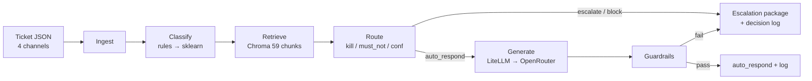
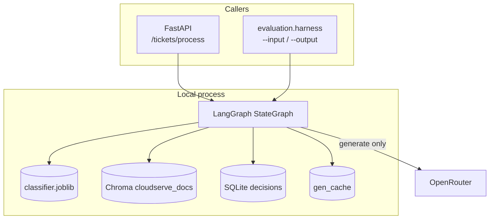
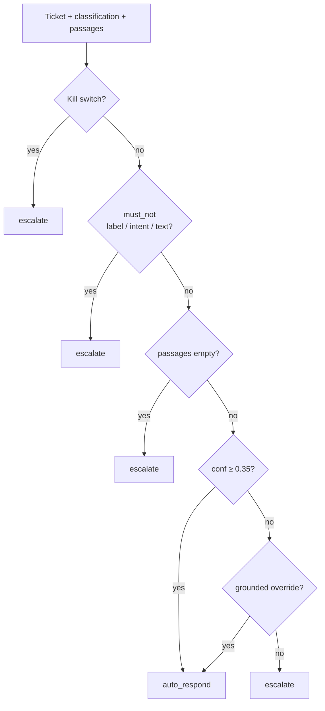
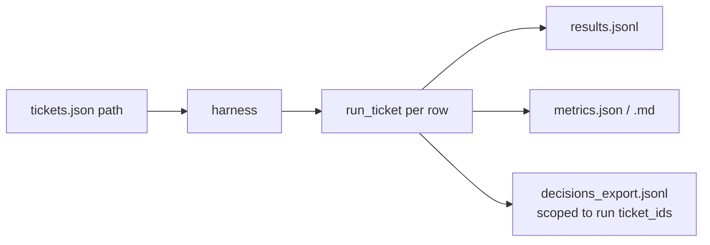

# Data flow — CloudServe Assistant

Use these diagrams in the README, report, and **video** (open PDF or this file beside the terminal).

## Purpose

CloudServe Assistant is a **support triage / assist** system (not a chatbot): ingest a ticket → classify locally → retrieve KB passages by `doc_id` → **route in code** → optionally generate a cited draft via LiteLLM→OpenRouter → guardrails → SQLite decision log.

## End-to-end pipeline

## Runtime topology

## Routing decision order

## Evaluation data flow

