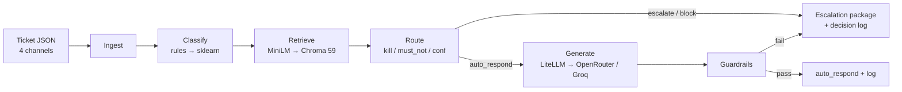
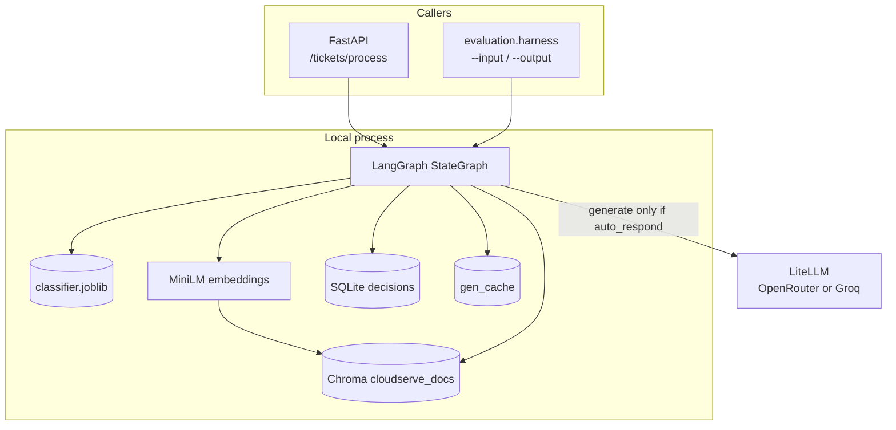
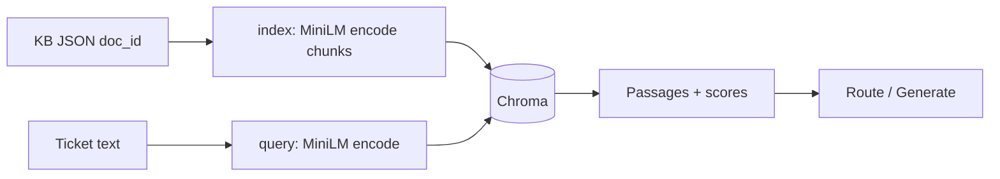
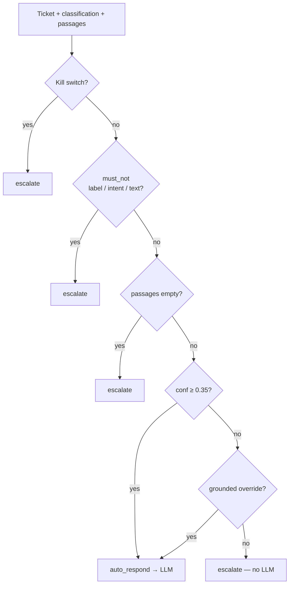
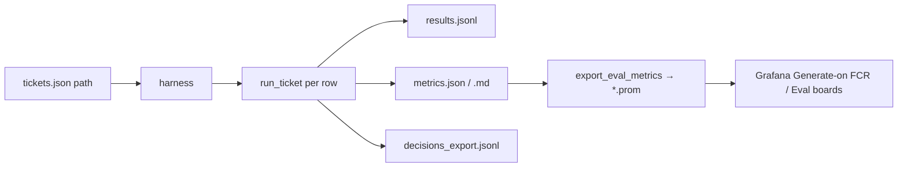

# Data flow — CloudServe Assistant

Use these diagrams in the README, report, and **video** (open PDF or this file beside the terminal).

## Purpose

CloudServe Assistant is a **support triage / assist** system (not a chatbot): ingest a ticket → classify locally → retrieve KB passages by `doc_id` → **route in code** → optionally generate a cited draft via LiteLLM (OpenRouter **or** Groq) → guardrails → SQLite decision log.

## End-to-end pipeline



## Runtime topology



## Where MiniLM fits



MiniLM is **retrieval only**. Classification is rules + sklearn. Draft text is LiteLLM → remote chat model.

## Routing decision order



## Evaluation data flow



## Observability (optional demo)

```mermaid
flowchart LR
  API[/metrics :8000] --> PROM[Prometheus]
  EXP[eval-exporter :9101] --> PROM
  PROM --> GRAF[Grafana :3000]
```
