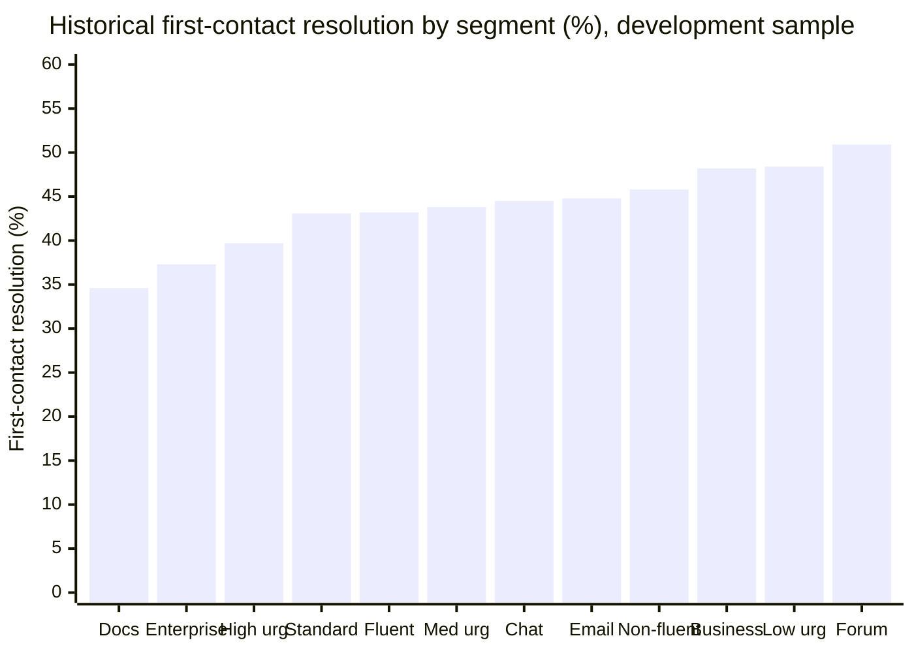
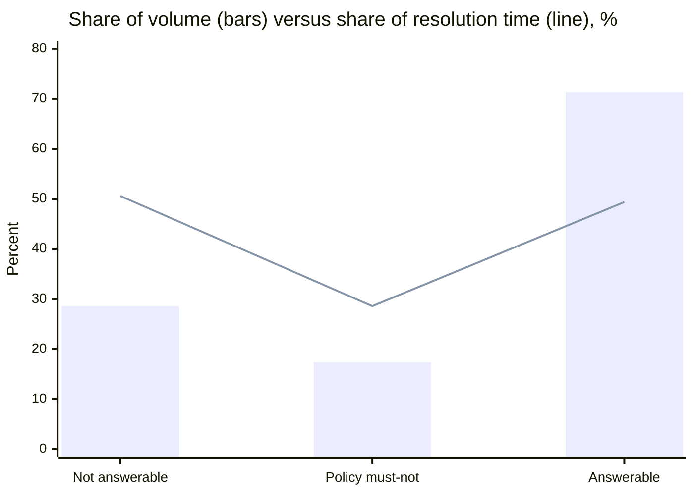
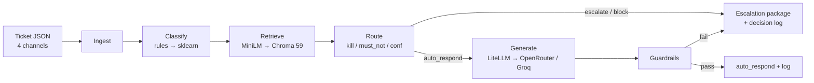
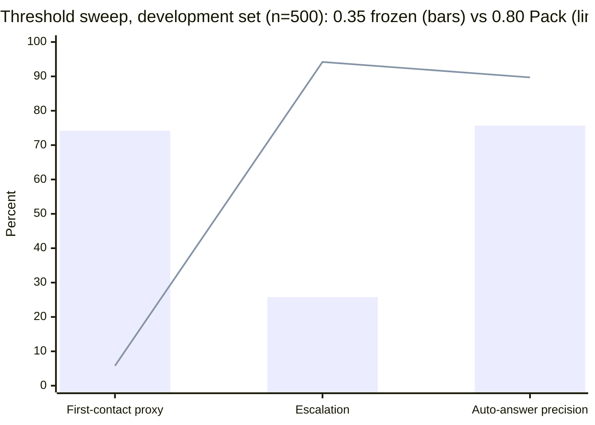
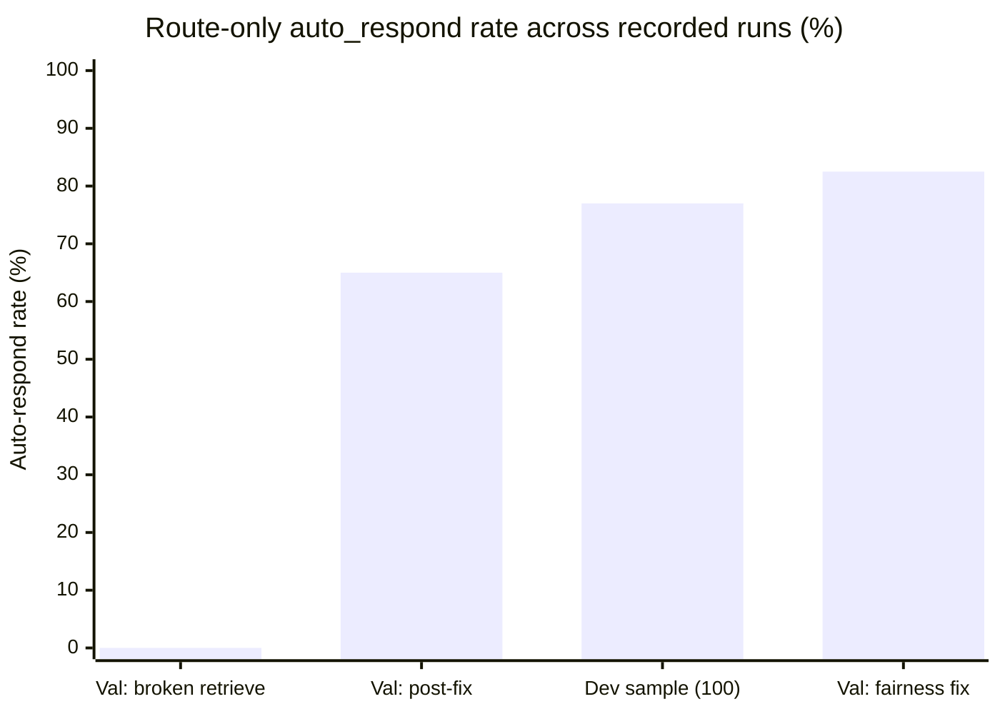
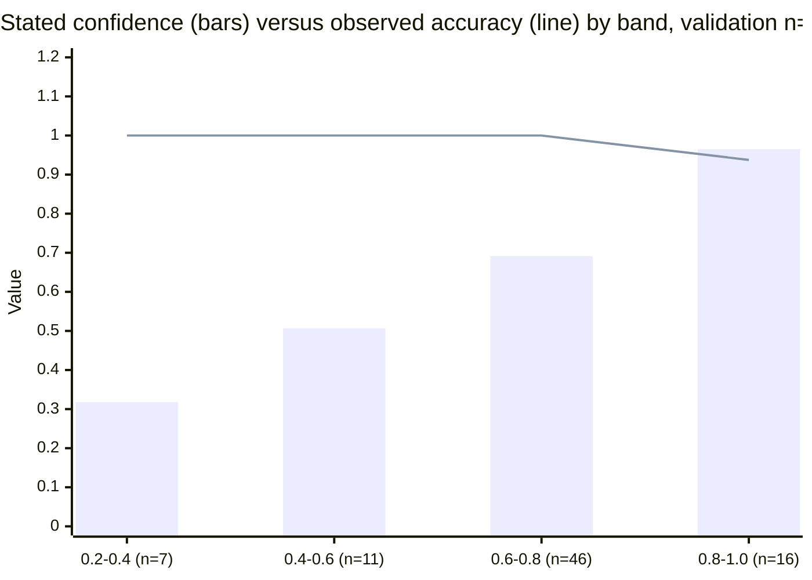
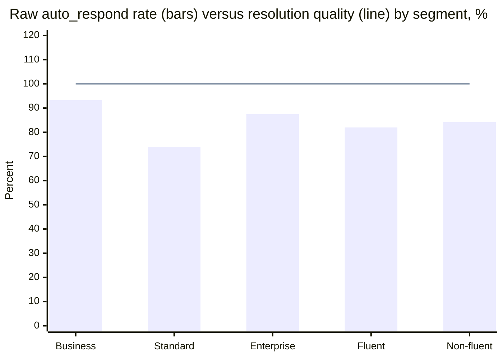
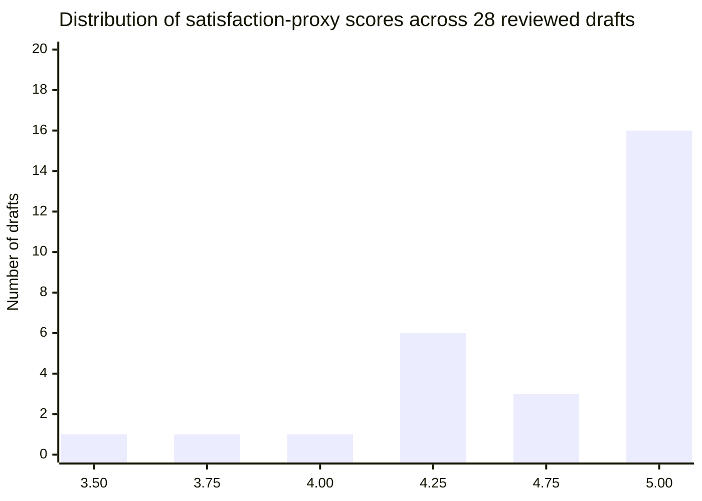
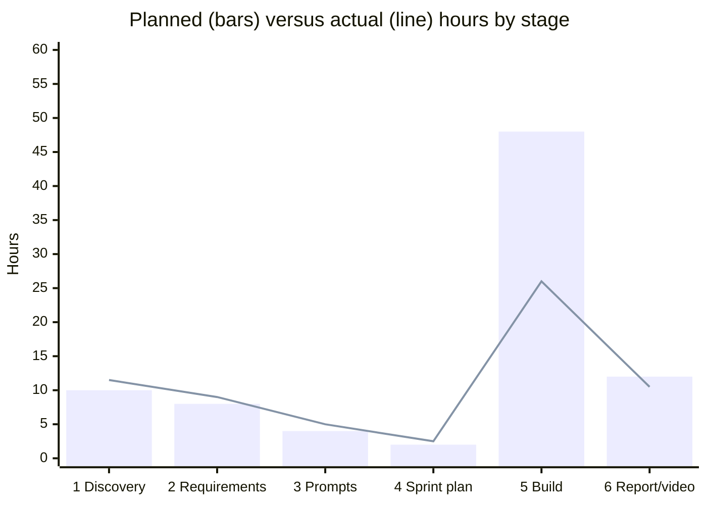

# CloudServe Assistant — Product Report

**Author:** Sameer J  
**Product:** CloudServe Assistant (RAG triage and assist — not a chatbot)  
**Client context:** CloudServe Solutions support organisation  
**Date:** 2026-11-28  
**Version:** 1.4  

**Declaration of AI tool use.** Planning, drafting, coding assistance and workbook and report drafting were supported by AI coding assistants (including Cursor agents). The builder is responsible for configuration choices, the threshold freeze, the recorded evaluation commands and the correspondence between a clean checkout, this report and the [README](../../README.md). Ticket and knowledge-base *content* from the reference datasets pack was not used for planning insight; development-ticket figures come from aggregate scripts and interview transcripts, as the Pack requires.

**About this report.** This report describes CloudServe Assistant in the third person, as a product that a reviewer can assess without having watched the build. Every figure is taken from a recorded artefact of the repository: discovery script output, [threshold-freeze.md](../plan/threshold-freeze.md), [eval-runs.md](../plan/eval-runs.md), the recorded metrics files, [human_eval_appendix.md](../workbooks/human_eval_appendix.md), the governance documents, or the workbooks (including [Effort_Log.md](../workbooks/Effort_Log.md)). The demonstration is [demo.mp4](../video/demo.mp4). Remaining package items are listed in section 10.

---

## Summary

CloudServe Assistant is a support triage and assist service for the CloudServe Solutions support organisation. It accepts a ticket from any of four channels, classifies intent and urgency with deterministic rules followed by a locally trained scikit-learn classifier, retrieves passages from the 29-article knowledge base through a Chroma vector index, and routes the ticket in plain code. A ticket that is policy-restricted, poorly grounded or low in confidence is escalated with a readable reason, a summary and the sources considered. A confident, well-grounded ticket receives a cited draft produced through **LiteLLM → Groq** (or OpenRouter, configurable), which passes blocking guardrails before anything is treated as sendable. Every decision is written to a SQLite decision log, a kill switch stops automatic answering without a redeploy, and an unattended harness takes `--input` and `--output` so that a grader can run the system on an injected ticket file.

**Table S1.** Key results on the 80-ticket validation file (generate-on run `validation_20261122T131433Z`; LiteLLM → Groq).

| Measure | Result | Target |
|---------|--------|--------|
| Customer first-contact resolution | 82.5% (`fcr_claim_allowed=true`) | at least 60% |
| Escalation rate | 17.5% (14 of 80, all policy must-not) | at most 30% |
| Intent classification accuracy | 98.75% (79 of 80) | at least 85% |
| Fairness quality gap (tier / fluency) | 0.0 / 0.0 percentage points | under 5 points |
| Citation ID validity | 1.0 (65 of 65 generations) | at least 95% |
| Human review (28 drafts) | Satisfaction proxy 4.68; 119 of 119 claims supported | at least 4.0; at most 5% hallucination |
| Test suite / index | 28 pytest tests pass; 59 Chroma chunks | A12 / A4 |

Route-only validation (`validation_fairness_fix`) gives the same 66 auto_respond / 14 escalate split without a customer-resolution claim. Hidden-set runs completed: **zero** (not available to the builder; graders inject once near the end). Demonstration: [demo.mp4](../video/demo.mp4) (packaged as `SameerJ_Capstone_Video.mp4`).

---

## 1. Problem and stakeholders

### 1.1 The business problem

CloudServe Solutions’ support organisation is missing its first-response service agreement while ticket volume grows. Marcus Adeyemi, Head of Support, reports roughly five hundred tickets a week handled by six agents, with first response averaging eight to twelve hours against a two-hour agreement. Two hires and a canned-response library did not fix the problem, because agents found searching the library slower than writing the answer again, and outsourcing quotes exceeded the budget. The development ticket sample contains exactly 500 tickets, close to one week of volume, and is a reasonable picture of the queue the system is meant to relieve.

The historical labels on that sample show a first-contact resolution rate of 43.8% (219 of 500) and an escalation rate of 56.2% (281 of 500). Marcus quotes 42%, so the two sources agree closely. The ticket data carries an elapsed resolution time, with a mean of 421.7 minutes per ticket, but no first-response timestamp. First-reply time as Marcus defines it therefore cannot be verified from the tickets; the discovery workbook records this as an open question (section 2.6).

### 1.2 The ask and the diagnosis

The client’s initial ask was a chatbot. The discovery interviews point elsewhere: each of the five stakeholders described a different part of the same underlying problem, and none described a need that a conversational assistant would meet. Table 1 summarises what each stakeholder needs and fears.

**Table 1.** Stakeholder needs and feared failure modes, drawn from the five discovery interviews.

| Stakeholder | Need from the system | Failure mode they fear |
|-------------|----------------------|------------------------|
| Marcus Adeyemi, Head of Support | Higher first-contact resolution without unsafe automation; explainable decisions for an autumn compliance review | A wrong confident answer that engineers screenshot; more agent work than the system saves |
| Sofia Restrepo, Tier One agent | A cited draft and the relevant page so she stops searching a private snippet file | Search that still fails under real customer wording; apologising for a wrong automated reply |
| Daniel Okonkwo, Tier Two engineer | Escalations that show what was tried, which pages were considered and what was uncertain | Bare forwards that force him to re-read the thread and re-ask the customer |
| Ines Varga, Technical Writer | Visibility of which article an answer cited, so she can tell an article error from a misreading | Unreviewed private answer files remaining the real source of truth |
| Ravi Menon, customer | A fast, honest, labelled first reply with a page link; urgent failures separated from mild how-to waits | Certain-sounding wrong answers |

Sofia says that roughly seven in ten tickets are repeats she could answer quickly if she could find the right page, and that the documentation is fine but unfindable. Ines, who maintains the 29 knowledge-base articles, says they are accurate within the review cycle and used heavily by customers but hardly at all by support, because internal search matches article titles rather than customer wording. Daniel estimates that about half of what reaches him is something Tier One could have closed with confidence and the right page, and asks that an automated system show its working rather than merely be right. Ravi accepts an automated first reply if it says what the system thinks, names the source page and says that a person will confirm; he rejects confident error. Marcus defines failure as shipping something wrong and would rather the system said nothing.

Taken together, the interviews describe a findability and context problem rather than a conversation problem. The answers exist, the people who need them cannot reach them quickly, and escalations lose context on the way up. The product is therefore **CloudServe Assistant**: it ingests tickets from four channels, classifies intent and urgency locally, retrieves passages by `doc_id`, and either drafts a cited auto-response or escalates with a readable reason, a summary and the sources. Guardrails can block unsafe drafts, every automated decision is logged, and an unattended harness evaluates an injected ticket path.

### 1.3 What success means

The CloudServe Project Brief contains two target tables that disagree. One, closer to a client wish list, quotes first-contact resolution of 65% or more, a two-hour first reply and a satisfaction score of 4.2. The other, the success and outcomes table with explicit calculation definitions in the Evaluation Framework, quotes first-contact resolution of at least 60%, a mean first reply under five minutes, a satisfaction proxy of at least 4.0 and an escalation rate of at most 30%. The project adopted the second table as the pass bar and treats the first as context (finding D1, [findings.md](../plan/findings.md)). Table 2 lists those targets and the pre-system historical baseline from the human-handled development sample. System results against the targets appear in section 8 (Tables 21 and 21a).

**Table 2.** Success targets, their sources, and the historical human baseline (not system results).

| Measure | Target (pass bar) | Source of the target | Historical baseline before the system (development sample) |
|---------|-------------------|----------------------|------------------------------------------------------------|
| First-contact resolution | at least 60% | Success table (finding D1) | 43.8% (human-handled) |
| Escalation rate | at most 30% | Success table (finding D1) | 56.2% (human-handled) |
| Mean time to first reply | under 5 minutes | Success table (finding D1) | Not in ticket schema (no first-response field) |
| Customer satisfaction proxy | at least 4.0 | Success table; human rubric sample | Mean historical rating 2.97 |
| Intent classification precision | at least 85% | Evaluation Framework | Not applicable (no prior classifier existed) |
| Hallucination / citation accuracy | at most 5% / at least 95% | Evaluation Framework; human review | Not applicable historically (no automated replies) |
| Fairness quality gap | under 5 percentage points | Evaluation Framework governance tier | Not applicable historically (no automated path) |
| Private data in outbound replies | zero | Governance Framework | Not applicable historically (no automated outbound drafts) |

The discovery workbook adds a second constraint. In the development sample, 143 tickets (28.6%) are not answerable from the documentation and 87 (17.4%) are policy-restricted and must never be auto-answered. Both groups were always escalated in the historical record. A ceiling on automation therefore exists, and the value of the system lies in routing correctly and handing over context, not in answering more tickets. The counter-metrics in the product requirements document make this explicit: the system must not maximise its auto-respond rate if doing so raises hallucination, and it must not chase classification accuracy by answering tickets it cannot ground.

---

## 2. Discovery and findings

### 2.1 Method

Discovery combined five stakeholder interview transcripts with aggregate statistics over the 500-ticket development file. A project rule governed the second source: ticket and knowledge-base content were never read by hand for planning insight. Every development-ticket figure in this report was produced by running `python -m scripts.discovery_stats --input <development_tickets.json>`, which prints counts, rates and per-segment means from the `labels` and `history` fields and no ticket text. Where a figure is simple arithmetic on that output, such as a share of 500, the arithmetic is shown in the workbook. When two stakeholders disagreed, the disagreement could be settled by a reproducible command rather than by choosing whom to believe.

### 2.2 Disagreements settled by data

The interviews disagreed in six places. Table 3 states each disagreement, how the aggregates settled it and what followed for the design. The supporting numbers appear in Tables 4 and 5.

**Table 3.** Interview disagreements and how the development aggregates settled them.

| Disagreement | What the data showed | Consequence for the product |
|--------------|----------------------|-----------------------------|
| How many escalations Tier One could have resolved (Daniel: about half) | Of 281 escalations, 138 (49.1%) were answerable from documentation and 107 (38.1%) were answerable and not policy-restricted. | A large part of the escalation load is a findability and confidence problem. Automation can lift first-contact resolution without touching genuinely hard tickets. |
| How repetitive the work is (Sofia: seven in ten) | 71.4% of tickets (357 of 500) are answerable from documentation, but the intent mix is flat: the largest intent is 5.8% and the smallest 2.6%. | Repetition sits at the article level, not the topic level. A topic-based canned-response library would need more than twenty buckets; retrieval over 29 articles with citations fits better. |
| Whether the documentation is the problem (Sofia and Ines) | Answers exist for 71.4% of tickets, yet 38.1% of escalations were answerable and non-policy: the answers were available and unused. | Build meaning-based retrieval with citations rather than rewrite content; restrict the corpus to the 29 reviewed articles. |
| Whether non-fluent customers have the worst satisfaction (Sofia) | 120 tickets (24.0%) are non-fluent. Satisfaction is 3.04 versus 2.95 for fluent customers; resolution takes 466.1 versus 407.7 minutes (14.3% longer). | No historical satisfaction gap is claimed. Fluency remains a fairness segment because the new system may misread non-fluent wording. |
| One response-time number versus urgency-dependent pain (Marcus and Ravi) | High-urgency tickets are 29.2% of volume and fare worse: first-contact resolution 39.7% versus 48.4% for low urgency. | Urgency is an explicit classification output and appears on escalations; reporting should be split by urgency. |
| Whether enterprise customers are better served (Ravi) | Enterprise tickets (83, or 16.6%) have the lowest first-contact resolution (37.3%) and the highest escalation rate (62.7%). | Enterprise is not treated as well served a priori; tier remains a fairness segment. |

### 2.3 The development sample in numbers

Table 4 collects the main aggregates. The sample has 22 intent labels, no missing intent or urgency label, four channels and three customer tiers. Email is the largest channel at 212 tickets, and more than a quarter of the volume (26.6%) arrives as documentation comments or forum posts, which no interviewee mentioned but which the system must ingest without channel-specific failure.

**Table 4.** Development sample aggregates (`development_tickets.json`, n=500), produced by `scripts.discovery_stats`.

| Measure | Figure |
|---------|--------|
| Channels | email 212, chat 155, docs_comment 78, forum 55 |
| Urgency | medium 226, high 146, low 128 |
| Customer tier | standard 253, business 164, enterprise 83 |
| Language fluency | fluent 380, non-fluent 120 |
| Answerable from documentation | 71.4% (357 of 500) |
| Policy must_not_auto_respond | 17.4% (87 of 500) |
| Historical first-contact resolution / escalation | 43.8% (219) / 56.2% (281) |
| Repeat contact | 21.6% |
| Mean historical satisfaction | 2.97 |
| Mean resolution time | 421.7 minutes (sum 210,849 minutes) |
| Documentation corpus | 29 articles (`documentation.json`, field `doc_id`) |

The segment outcomes in Table 5 show that human handling is not uniform, and Figure 1 draws the first-contact resolution column for comparison. Enterprise customers do worst on first contact and on speed. Documentation comments are the slowest channel and the most repeated, with a repeat-contact rate of 33.3%. Chat has the lowest satisfaction, at 2.72. The history is a baseline to improve on, not a target to imitate, a point Daniel makes when he warns that some answers in agents’ private files were right two years ago and are wrong now.

**Table 5.** Historical outcomes by segment in the development sample (human-handled tickets).

| Segment | Tickets | First-contact resolution | Mean resolution (min) | Mean satisfaction |
|---------|---------|--------------------------|-----------------------|-------------------|
| Standard tier | 253 | 43.1% | 442.1 | 2.98 |
| Business tier | 164 | 48.2% | 358.8 | 2.91 |
| Enterprise tier | 83 | 37.3% | 483.7 | 3.05 |
| Fluent | 380 | 43.2% | 407.7 | 2.95 |
| Non-fluent | 120 | 45.8% | 466.1 | 3.04 |
| High urgency | 146 | 39.7% | 478.5 | 2.86 |
| Medium urgency | 226 | 43.8% | 402.7 | 2.99 |
| Low urgency | 128 | 48.4% | 390.6 | 3.06 |
| Email | 212 | 44.8% | 381.7 | 3.08 |
| Chat | 155 | 44.5% | 426.7 | 2.72 |
| Docs comment | 78 | 34.6% | 514.7 | 3.17 |
| Forum | 55 | 50.9% | 430.1 | 2.98 |



**Figure 1.** Historical first-contact resolution by segment, values from Table 5 (Docs = documentation comments; urg = urgency). The lowest segments are documentation comments, enterprise tier and high-urgency tickets.

### 2.4 Where the effort goes

Effort was proxied by elapsed resolution minutes summed per category, which overstates effort on tickets that waited in queue but still ranks categories usefully. Table 6 and Figure 2 show the central discovery result. Tickets that are not answerable from documentation are 28.6% of volume and 50.6% of elapsed resolution time. Policy-restricted tickets are 17.4% of volume and 28.6% of time. Four intents that automation must not handle (security incidents, compliance requests, data residency and feature requests) are 20.2% of volume and 32.0% of time. The answerable tickets, 71.4% of volume, carry 49.4% of time. The time saving must therefore come from answerable tickets, while the genuinely hard tickets need better handovers rather than answers.

**Table 6.** Share of ticket volume versus share of elapsed resolution time, development sample.

| Ticket group | Share of volume | Share of resolution time | Why the two differ |
|--------------|-----------------|--------------------------|--------------------|
| Not answerable from documentation | 28.6% (143) | 50.6% | Nothing to retrieve; all escalated; mean resolution 746.8 versus 291.5 minutes for answerable tickets |
| Policy must-not tickets | 17.4% (87) | 28.6% | Always escalated; mean resolution 693.2 minutes |
| Answerable from documentation | 71.4% (357) | 49.4% | Documented procedures resolve faster |
| security_incident (single intent) | 5.2% (26) | 9.7% | Longest mean resolution of any intent, 785.9 minutes |
| sso_configuration (single intent) | 5.2% (26) | 2.4% | Documented procedure; 73.1% resolved at first contact |



**Figure 2.** Volume (bars) versus effort (line) for three overlapping ticket groups, values from Table 6. The groups are cuts of the same 500 tickets and are not a partition.

### 2.5 Findings D1–D5

Reading the reference datasets pack surfaced five conflicts or errors, logged in [findings.md](../plan/findings.md). Each carries a stance that later documents and code cite by identifier; changing a finding requires a logged revision.

- **D1 — One success bar.** The Pack’s two success tables disagree. Stance: adopt the Evaluation Framework table — first-contact resolution at least 60%, reply under 5 minutes, satisfaction at least 4.0, escalation at most 30%.
- **D2 — `doc_id`, never `id`.** The Setup Guide sample indexes documents by `id`. Stance: the field is `doc_id` everywhere, matching the Dataset Guide and ground-truth links.
- **D3 — Measure, then freeze the threshold.** Pack `CONFIDENCE_THRESHOLD=0.80` is illustrative. Stance: measure on development data; freeze the operating value at **0.35** before recorded evaluation. At 0.80 the tune set auto-responds on 5.8% of tickets; at 0.35, 74.2% with escalation 25.8%. Full freeze record: [threshold-freeze.md](../plan/threshold-freeze.md).
- **D4 — Kill switch with defined in-flight behaviour.** The Brief leaves in-flight work underspecified. Stance: environment flag or file, re-read live, checked at route and around generation; never auto_respond while on.
- **D5 — No GLiNER; supervised classifier.** The zero-shot plan was dropped. Stance: rules plus a supervised scikit-learn classifier; the language model only generates and never labels.

**Table 7.** Reference datasets pack deviations logged as findings D1–D5.

| ID | Finding | Stance taken |
|----|---------|--------------|
| D1 | Pack success tables disagree slightly | Locked targets: first-contact resolution at least 60%, reply under 5 minutes, satisfaction at least 4.0, escalation at most 30% |
| D2 | Setup Guide sample uses `id` for corpus documents | Always use `doc_id`, the field in the Dataset Guide and the ground-truth links |
| D3 | Pack `CONFIDENCE_THRESHOLD=0.80` is illustrative | Operating threshold measured then frozen at 0.35 (tune: 74.2% FCR proxy vs 5.8% at 0.80) |
| D4 | Kill-switch behaviour for in-flight work is underspecified | Environment flag or file; re-read live; checked at route and around generation; never auto_respond while on |
| D5 | The GLiNER zero-shot plan | Dropped for rules plus a supervised scikit-learn classifier; the language model only generates, never labels |

Three further Pack inconsistencies were tracked without becoming product deviations. The hidden set is stated as 100 tickets in some places and 120 in others, so the harness accepts an arbitrary number of tickets with the same schema. The validation set is described both as free to use and as to be run once near the end; the project tuned on the development file and used the validation file for self-checks (run history in section 8.2). The Setup Guide’s category-count wording differs from its listed categories, so enumerations come from the Dataset Guide and from scripts.

### 2.6 Open questions and their disposition

Four open questions from the discovery workbook shaped the evaluation. Each was closed or deferred as follows:

- **First-reply time is not in the ticket data.** Disposition: the harness reports reply-time as a latency proxy (mean, median, p95). Generate-on batch: 0.14 min mean, 0.32 min p95 (section 8.3).
- **Customer region was not analysed.** Disposition: fairness checks run on tier and fluency only; a region segment remains a next step (section 10.3).
- **The satisfaction scale is not stated in the data.** Disposition: the one-to-five scale of the Brief is assumed; human rubric scores use that scale (section 8.6).
- **Marcus’s claim that an escalation costs about four times a resolved ticket.** Disposition: not present in the data; the cost ratio is unused in any target.

---

## 3. Requirements and acceptance

### 3.1 Functional requirements

The product requirements document defines thirteen functional requirements. FR-1 to FR-6 cover the pipeline stages: four-channel ingest, intent and urgency with confidence, corpus retrieval with resolvable sources, threshold routing, grounded cited generation and blocking guardrails. FR-7 and FR-8 cover the persistent decision log and the kill switch. FR-9 to FR-12 cover the unattended harness, the documented runnable service, graceful failure and the one-command test suite. FR-13 covers the discovery scripts that produce the Stage 1 aggregates without manual inspection of ticket bodies. Each requirement has testable consequences — for example, an identical ticket processed twice yields the identical route, and an engineered trigger ticket produces a blocked response that is not sent. Table 8 maps each requirement to the module that realises it.

**Table 8.** Functional requirements and the modules that implement them.

| ID | Requirement | Capability | Module or script |
|----|-------------|------------|------------------|
| FR-1 | Four-channel ingest | Normalise email, chat, docs_comment and forum tickets | `src/ingest.py`, `src/models.py` |
| FR-2 | Intent, urgency, confidence | Rules first, then trained classifier; alternatives recorded | `src/classify.py`, `scripts/train_classifier.py` |
| FR-3 | Retrieval | Ranked passages with `doc_id`; empty result allowed | `src/retrieve.py`, `scripts/build_index.py` |
| FR-4 | Threshold routing | Pure deterministic routing with a frozen threshold | `src/route.py` |
| FR-5 | Grounded generation | Cited JSON answer through LiteLLM (OpenRouter or Groq); disk cache | `src/generate.py`, `src/llm.py`, `src/cache.py`, `prompts/generate_v1.md` |
| FR-6 | Blocking guardrails | Citation, PII, injection, scope and confidence checks | `src/guardrails.py` |
| FR-7 | Decision log | One row per automated decision stage | `src/logging_store.py` |
| FR-8 | Kill switch | Live environment flag or file | `src/config.py`, `src/route.py`, `src/graph.py` |
| FR-9 | Harness | `--input` and `--output`; metrics written automatically | `evaluation/harness.py`, `evaluation/metrics_report.py` |
| FR-10 | Runnable service | FastAPI with `/health`, `/metrics`, `/tickets/process` | `src/api.py`, `README.md` |
| FR-11 | Graceful failure | Timeout, backoff, per-ticket error isolation | `src/graph.py`, `src/llm.py` |
| FR-12 | Tests | One pytest command | `tests/`, CI workflow |
| FR-13 | Discovery scripts | Aggregates only | `scripts/discovery_stats.py` |

### 3.2 Non-functional requirements

Table 9 lists the cross-cutting requirements and the mechanism that serves each. The [architecture design](../design/architecture/architecture-design.md) maps them to design choices; section 8 reports the recorded evidence.

**Table 9.** Non-functional requirements and mechanisms.

| ID | Requirement | Mechanism |
|----|-------------|-----------|
| NFR-01 | Latency p95 under 3 seconds end to end | Local classify and retrieve; cache hits; generation skipped on escalation |
| NFR-02 | Availability at least 99.5% with documented provider-down behaviour | Provider failure becomes escalation; the batch continues |
| NFR-03 | Classification precision at least 85%; citation accuracy at least 95%; hallucination at most 5% | Trained classifier; citation guard; human review |
| NFR-04 | Zero private data in outbound replies | Blocking pattern guardrail; governance scan in the metrics report |
| NFR-05 | Complete decision auditability | SQLite decision log, export and harness reconciliation |
| NFR-06 | Under 5 points quality variation across tier and fluency | Segment quality metric in the harness; character n-gram classifier; grounded override |
| NFR-07 | Free-tier cost only | Local classification; cache; escalate-before-generate; backoff on rate limits |

### 3.3 Acceptance criteria (final)

**Last run:** 2026-11-22 (generate-on `validation_20261122T131433Z`). The acceptance criteria A1 to A12 from the CloudServe Build Specification are the gate. Table 10 gives the final status of each.

**Table 10.** Acceptance criteria A1–A12 — final status.

| ID | Criterion (short) | Status | Evidence |
|----|-------------------|--------|----------|
| A1 | Clean checkout runnable | Pass | Classifier and index rebuild from an empty `storage/` via `setup_all.sh`; steps in section 8.8 and Appendix H |
| A2 | Four-channel ingest | Pass | Tests, including coercion of malformed channel values |
| A3 | Intent, urgency, confidence, alternatives | Pass | Classifier tests; alternatives on rules and model paths |
| A4 | Retrieval with resolvable `doc_id` | Pass | Chroma collection `cloudserve_docs`, 59 chunks |
| A5 | Deterministic routing | Pass | Twice-run tests |
| A6 | Cited, grounded answers | Pass | Citation-membership guard; generate-on citation ID validity 1.0 (65 of 65); human review 119 of 119 claims supported (Table 24) |
| A7 | Blocking guardrails | Pass | Engineered bad generation is blocked through the graph |
| A8 | Decision log and coverage | Pass | Harness reconciliation reports tickets without a decision row (zero) |
| A9 | Unattended harness | Pass | `--input` / `--output`; route-only `validation_fairness_fix` and generate-on `validation_20261122T131433Z` |
| A10 | Metrics report | Pass | `fcr_claim_allowed=false` on route-only; `fcr_claim_allowed=true` with FCR 82.5% on generate-on |
| A11 | Provider failure resilience | Pass | Timeout, rate-limit backoff and malformed ticket mid-batch (mocked); live Groq batch completed |
| A12 | Documented pytest suite | Pass | 28 tests |

### 3.4 Scope

Out of scope for version one are a consumer chat interface, billing settlement or contractual commitment engines, an agent desktop beyond API responses, automatic closure of tickets in an external system, multi-region deployment, a fine-tuned model, and any unsupervised handling of security, legal or data-location matters. The non-goals also exclude paying for model capacity, tuning against the hidden set, hard-coding its path, and extra test suites or dashboards beyond what the CloudServe requires. Each follows from stakeholder evidence, notably Daniel’s list of categories he would not automate and Marcus’s insistence that a wrong answer is worse than silence.

### 3.5 How the requirements changed

The product requirements document was revised from version 1.0 to version 2.0 during the build, and the Stage 5 revision log records fourteen numbered changes, C-01 to C-14. Table 11 lists the changes that altered behaviour; each was triggered by recorded evidence. Three version 1.0 assumptions were revised: the Pack’s 0.80 threshold would have escalated nearly everything, a rules-plus-GLiNER classifier was unnecessary once labelled data was available, and raw auto-respond rates were the wrong basis for a fairness metric.

**Table 11.** Selected requirement changes from the Stage 5 revision log.

| Change | Requirement | What changed | Trigger |
|--------|-------------|--------------|---------|
| C-01 | FR-02 | GLiNER dropped; supervised classifier added; no language-model labelling | Finding D5 |
| C-02 | FR-04 | Threshold measured and frozen at 0.35 instead of the Pack default of 0.80 | Threshold sweep: FCR proxy 5.8% at 0.80 versus 74.2% at 0.35 |
| C-03 | FR-04 | Routing confidence is the intent probability only | Taking the minimum with urgency collapsed first-contact resolution |
| C-04 | FR-04 | Grounded override for strong retrieval with near-threshold confidence | First fairness measurement showed a tier gap of about 35 points |
| C-05 | FR-04 | Label-free text rules for security, legal and self-harm language | The hidden set may omit the `must_not_auto_respond` label |
| C-06 | FR-08 | In-flight kill-switch behaviour specified | Gap review found a race between operator and generation |
| C-07 | NFR-06 | Fairness measured as resolution quality, not raw auto mix | Structural unevenness of policy tickets across tiers |
| C-08 | FR-09, FR-10 | One LangGraph state graph shared by API and harness | Pack stack names LangGraph; gap review found none |
| C-09 | FR-11 | Timeout, bounded retries and exponential backoff | A11 was only partly demonstrated |
| C-10 | FR-09 | No first-contact-resolution claim on route-only runs | A route-only figure would overstate results |
| C-11 | FR-03 | Embedding-dimension check and index health on `/health` | First gate run escalated all 80 tickets |

---

## 4. Architecture

### 4.1 Design paradigm and data flow

CloudServe Assistant uses a pipes-and-filters design on a single LangGraph `StateGraph` in `src/graph.py`. Each stage is a filter module with typed inputs and outputs, and the graph is the only orchestrator. FastAPI and the evaluation harness both call the same `run_ticket` entrypoint, so a metric measured by the harness describes the behaviour the API would show. Figure 3 shows the end-to-end data flow; the canonical version, with runtime topology and routing order, is [data-flow.md](../design/architecture/data-flow.md).



**Figure 3.** CloudServe Assistant data flow as a LangGraph state graph. Tickets that route to escalate skip generation and guardrails; remote LLM traffic (LiteLLM to OpenRouter or Groq) exists only on the generate node.

The nodes run in this order: ingest, classify, retrieve, route, generate (conditional on the route being auto_respond), guardrails and persist. The graph state carries the ticket, classification, retrieved passages, the route decision, the generation, the guardrail results, the final action, accumulated errors and an escalation summary. Each node catches its own exceptions, appends an error note and degrades to a defined fallback, for example a zero-confidence classification or an empty passage list, so that a failure in one stage becomes an escalation rather than an exception that aborts the batch.

### 4.2 Architecture decisions

The [architecture spine](../design/architecture/ARCHITECTURE-SPINE.md) records eleven numbered decisions, AD-1 to AD-11. Table 12 lists those that shaped the code most. The connecting constraint is that probabilistic components are kept out of the decisions that must be reproducible: classification and routing never call a remote model, and the single remote call, generation, happens only after routing has decided to answer.

**Table 12.** Selected architecture decisions from `ARCHITECTURE-SPINE.md`.

| ID | Decision | What it prevents |
|----|----------|------------------|
| AD-1 | Only `run_ticket` executes the pipeline; the API and the harness must not reimplement stages | API behaviour diverging from harness metrics |
| AD-2 | Dependency direction: api to graph to stages to models, config and logging; stages never import the API | Circular imports; stages that the harness cannot share |
| AD-3 | Rules, then trained classifier, then code routing, then LiteLLM generation only on auto_respond | Non-deterministic routing; free-tier spend on classification |
| AD-5 | Every stage decision is persisted; the harness can export it | Incomplete audit evidence |
| AD-6 | Cache generation by model and prompt hash; honour rate-limit headers | Free-tier exhaustion on repeated evaluation |
| AD-7, AD-11 | Kill switch is a runtime flag read per ticket; in-flight policy specified | Needing a restart to stop automatic answers |
| AD-8 | Always use `doc_id`, never `id` | Broken index metadata and unresolvable citations |
| AD-9 | Threshold starts at the Pack value, is measured, then frozen before the recorded run | Drifting routing; invalidated evaluation |
| AD-10 | All remote completions go through `src/llm.py` (LiteLLM) | Provider calls scattered across modules |

### 4.3 Runtime topology and stack

At run time the system consists of an API process (`uvicorn` serving `src.api`), a harness process (`python -m evaluation.harness`) that uses the same graph, local in-process models for embeddings and classification, a Chroma persistent store on disk, a SQLite file for the decision log, a disk cache for generations, and one outbound HTTPS dependency used for generation only: an LLM provider reached through LiteLLM (OpenRouter or Groq). Table 13 summarises the components and what each is not used for.

**Table 13.** Runtime components and their responsibilities.

| Component | Responsibility | Not used for |
|-----------|----------------|--------------|
| LangGraph (with LangChain packages) | State graph orchestration | Business policy or thresholds |
| scikit-learn and joblib | Intent, urgency and confidence | Routing decisions; answer text |
| sentence-transformers (`all-MiniLM-L6-v2`) | Embedding passages and queries | Classification labels |
| Chroma | Persistent vector index | Decision audit |
| LiteLLM to OpenRouter/Groq | Draft answer generation | Classification or routing |
| FastAPI, uvicorn, pydantic | HTTP surface and typed models | The batch evaluation loop |
| SQLAlchemy with SQLite | Decision rows | Vector search |
| prometheus-client | Counters and latency histograms | Business satisfaction scoring |
| pytest | The A1 to A12 behaviour suite | Load or performance testing |

The stack follows the reference datasets pack configuration. The only additive dependency is `litellm`, plus configuration keys for the kill switch and the classifier path (logged in [requirements-pin-log.md](../plan/requirements-pin-log.md)). The one stack departure — replacing the GLiNER classification plan with the supervised classifier (finding D5) — was settled with the builder and recorded in the findings and the revision log.

### 4.4 Configuration and reproducibility

Every runtime setting is read from `.env`, with no fallback defaults in code. A missing or malformed numeric key raises a `ConfigError`, and a test covers that behaviour. Routing is only deterministic across runs (acceptance criterion A5) if the threshold and the grounded-override parameters cannot differ silently between invocations. The `.env.example` file ships with the frozen threshold, retrieval and chunking parameters, classifier training parameters, targets, kill-switch keys, resilience keys and both provider options (OpenRouter default; Groq optional). The `.env` file itself is git-ignored and excluded from the package.

---

## 5. Data and retrieval

### 5.1 Corpus and index

The retrieval corpus is the reference datasets pack’s `documentation.json`, which contains 29 reviewed support articles covering authentication, deployment, API usage, billing, data, security and account management. Each article has a `doc_id`, a title, a category and content. The corpus is deliberately small and closed: the agents’ private snippet files were never used, because some of their content is stale, and Ines wants every answer to trace to a reviewed article. The Pack’s ground-truth responses are used for evaluation only and are never retrieved at run time.

Articles are split into chunks of at most 800 characters with a 120-character overlap (`CHUNK_SIZE` and `CHUNK_OVERLAP`). The splitter respects paragraph boundaries where it can and falls back to windowed splitting for long paragraphs. Chunks are embedded with `sentence-transformers/all-MiniLM-L6-v2` and stored in a persistent Chroma collection named `cloudserve_docs` with cosine distance. After `scripts.build_index`, the collection holds 59 chunks, exposed as `chroma.count` on the `/health` endpoint. Table 14 lists the retrieval parameters.

**Table 14.** Retrieval and index configuration (from `.env.example`).

| Parameter | Value | Purpose |
|-----------|-------|---------|
| `EMBEDDING_MODEL` | `sentence-transformers/all-MiniLM-L6-v2` | Pack-pinned embedding model |
| `EMBEDDING_MIN_DIM` | 32 | Refuse an embedder that loaded without a trained pooling layer |
| `CHROMA_COLLECTION` | `cloudserve_docs` | Collection name |
| `CHUNK_SIZE` / `CHUNK_OVERLAP` | 800 / 120 | Chunking |
| `RETRIEVAL_TOP_K` | 5 | Passages returned per ticket |
| `RETRIEVAL_MIN_SCORE` | 0.25 | Relevance floor; below it a hit is dropped |
| Index size | 59 chunks | Observed after `scripts.build_index` |

### 5.2 Retrieval behaviour

Retrieval returns passages with a `doc_id`, the passage text, a similarity score and the article title. A passage below the relevance floor is dropped, so an irrelevant query can legitimately return nothing, and an empty result forces an escalation: the routing code refuses to approve an ungrounded answer. A citation that cannot resolve to a retrieved passage is blocked by the guardrails and never presented as a source. Finding D2 is enforced throughout: the metadata always stores `doc_id`, never a bare `id`.

### 5.3 The embedding-fallback incident

The most instructive retrieval event was a failure that produced no error. The first unattended run on the 80-ticket validation file escalated all 80 tickets, for a first-contact proxy of 0%. The cause, recorded in [eval-runs.md](../plan/eval-runs.md), was that the sentence-transformers library had silently fallen back to an untrained mean-pooling model when the pretrained model could not be loaded. The resulting vectors did not match those stored in the index, every similarity score fell below the relevance floor, retrieval returned no passages, and the router, behaving correctly, escalated every ticket.

The fix is a run-time check that refuses to proceed if the loaded embedding model has fewer dimensions than `EMBEDDING_MIN_DIM`, with an error that tells the operator to repair the model cache and rebuild the index, together with index statistics on `/health`. The episode illustrates a general risk of retrieval systems: a degraded dependency can fail safe — no wrong answer is sent — while failing completely, because no useful answer is sent either.

---

## 6. Classification and routing

### 6.1 Classification

Classification runs in two stages and never calls a remote model. Rules fire first for patterns that justify certainty: security language (compromise, breach, unauthorised access, phishing) maps to the security_incident intent with high urgency, and billing language (invoice, refund, charge, billing) maps to the billing_query intent. A rule hit carries a confidence of 1.0 and lists the other rule intents as alternatives so that the alternatives requirement of A3 is met on the rules path as well. Otherwise a trained scikit-learn pipeline predicts intent and urgency from the ticket text. Table 15 describes the components.

**Table 15.** Classification components.

| Component | Detail |
|-----------|--------|
| Rules | Two deterministic rule families (security and billing); confidence 1.0 |
| Features | Word n-grams (1 to 2) and character n-grams (3 to 5, `char_wb`) combined by TF-IDF |
| Model | Logistic regression for intent and a separate pipeline for urgency |
| Training data | Labelled development tickets (22 intents) via `scripts.train_classifier` |
| Output | Intent, urgency, confidence in [0, 1], up to three alternatives by probability |
| Artefact | `storage/models/classifier/classifier.joblib` (regenerated on a clean checkout) |

Routing confidence is the maximum intent probability, not the minimum of the intent and urgency probabilities. The first version took the minimum; because urgency prediction is weaker than intent prediction, that pushed most confidences under the measured threshold and collapsed the automated share. Urgency is still predicted, logged and returned, and it is visible on escalations, but it does not gate the reply (section 10.1). After the second training iteration, which added character n-grams for robustness to non-fluent wording, intent accuracy on the labelled validation tickets was 98.75% (79 of 80), as discussed in section 8.

### 6.2 Threshold measurement and freeze (D3)

The Pack’s `.env.example` ships `CONFIDENCE_THRESHOLD=0.80`, and the Brief calls that figure illustrative. The project measured instead. `scripts/tune_threshold.py` sweeps candidate thresholds from 0.30 to 0.95 in steps of 0.05 on the development labels and reports, for each, a first-contact proxy, an escalation share and the precision of the tickets it would auto-answer. Table 16 and Figure 4 show the two rows that matter. At the Pack value, 5.8% of tickets would be auto-answered and 94.2% escalated, because this classifier’s confidence distribution sits far below 0.80; at 0.35, 74.2% would be auto-answered with 25.8% escalated and an auto-answer precision of 0.7574. The chosen value is 0.35, frozen before the recorded validation run. The sweep was repeated after the confidence definition changed to intent-only and still recommended 0.35 ([threshold-freeze.md](../plan/threshold-freeze.md)).

**Table 16.** Development-set threshold sweep (n=500), values from [threshold-freeze.md](../plan/threshold-freeze.md) / `threshold_tune.json`.

| Threshold | First-contact proxy | Escalation | Auto-answer precision |
|-----------|---------------------|------------|-----------------------|
| 0.35 (frozen) | 74.2% | 25.8% | 0.7574 |
| 0.80 (Pack illustrative) | 5.8% | 94.2% | 0.8966 |



**Figure 4.** The same sweep as Table 16. Bars: threshold 0.35 (frozen); line: threshold 0.80 (Pack). Auto-answer precision is shown as a percentage (0.7574 → 75.7; 0.8966 → 89.7). A higher threshold increases precision and reduces automation.

The pack value is more precise per automated reply but automates almost nothing; an assistant that escalates 94.2% of tickets does not meet Marcus’s need. The business targets from finding D1 decided between the two. The frozen threshold is written to every routing decision as `threshold_applied`. Subsequent changes to the operating threshold require a logged PRD revision before a new recorded evaluation.

### 6.3 The route function

Routing is a pure function of the ticket, the classification, the retrieved passages, the settings and the kill-switch state. The order of the checks is fixed. Table 17 gives the order and the reason recorded with each outcome.

**Table 17.** Order of routing checks in `src/route.py`.

| Order | Check | Outcome | Recorded reason |
|-------|-------|---------|-----------------|
| 1 | Kill switch active | Escalate | Kill switch active; auto_respond disabled |
| 2 | Policy must-not (label or text rule) | Escalate | Policy: must_not_auto_respond, or the text rule name |
| 3 | No retrieved passages | Escalate | No passages above relevance; refusing ungrounded answer |
| 4 | Confidence at or above the frozen threshold | Auto-respond | Confidence and passage count with the top score |
| 5 | Grounded override: top score at least 0.45 and confidence at least 0.75 of the threshold | Auto-respond | Grounded override, with the numbers applied |
| 6 | Otherwise | Escalate | Confidence below threshold |

The grounded override addresses a specific observed problem. When the first fairness measurement was taken, the automated share differed by customer tier by about 35 percentage points, partly because classifier confidence is lower on some wording. Where retrieval is strong, the evidence for answering is good even if the classifier is a little unsure, so the override allows an auto-respond when the best passage scores at least `ROUTE_GROUNDED_MIN_SCORE` (0.45) and the confidence is at least `ROUTE_GROUNDED_CONF_FACTOR` (0.75) of the threshold. The override is segment-blind, is set in the environment, and is logged on the decision as `grounded_override=true`. The confidence-floor guardrail is skipped only when the override applied. Together with the character n-gram classifier, the override moved the validation first-contact proxy from 65.0% to 82.5% and closed the fairness gap.

### 6.4 Policy must-not rules

Tickets labelled `must_not_auto_respond` always escalate. Because the grader’s hidden set may not carry that label, the router also applies label-free text rules that detect security-incident language (data breach, ransomware, unauthorised access, compromised credentials), legal-threat language and self-harm language, so a hidden set without gold labels cannot bypass the policy by omission. A test covers this behaviour. The rules are short and conservative; they make the label optional rather than replace it. Daniel’s list of categories he would never automate (security incidents, account compromise, contractual billing disputes and data location) is the policy these rules and the label jointly support, and the development sample confirms its size: 17.4% of tickets.

---

## 7. Generation, guardrails, and kill switch

### 7.1 Generation

Generation happens only when the route is auto_respond and at least one passage exists. The prompt, `PR-GEN-01` in `prompts/generate_v1.md`, instructs the model to answer only from the supplied passages, to say that it does not know when the passages are insufficient, to cite supporting passages by `doc_id`, never to invent identifiers, never to make refund, legal or security-incident commitments, and to label the reply as automated. The ticket text is untrusted data: it is placed between `TICKET_BEGIN` and `TICKET_END` delimiters in the user message and never in the system message, and the passages sit between their own delimiters. The runtime sends the prompt’s System section as the system message and appends the JSON-only output contract (answer, cited `doc_id` values, automated-disclosure flag) to the user message as well.

Remote calls go through **LiteLLM** to a configurable provider. The recorded generate-on batch (`validation_20261122T131433Z`) used **Groq** (`LITELLM_MODEL=groq/qwen/qwen3.8-27b`, `LITELLM_API_BASE=https://api.groq.com/openai/v1`, `GROQ_API_KEY`) and produced 65 cited generations with citation ID validity 1.0. The default configuration in `.env.example` uses OpenRouter (`MODEL_NAME=openrouter/free`, `LITELLM_MODEL=openrouter/openrouter/free`, `LITELLM_API_BASE=https://openrouter.ai/api/v1`, `OPENROUTER_API_KEY`); switching providers is an environment change with no code change. Sampling is fixed at a temperature of 0.1 with a timeout of 30 seconds and up to three retries with exponential backoff on rate-limit responses. A disk cache keyed by model and prompt content avoids repeated calls, which matters under free-tier rate limits.

### 7.2 Guardrails

Every candidate generation is validated, and the validation is able to block. Table 18 lists the checks. A blocked generation is never treated as sendable and the ticket is escalated with the guardrail details as the reason. Guardrails are deterministic code; they do not ask a second model to judge the first.

**Table 18.** Blocking guardrails in `src/guardrails.py`.

| Check | What it detects | Blocks when |
|-------|-----------------|-------------|
| `nonempty_answer` | Empty generation | Answer is empty |
| `citation_ids` | Fabricated or foreign citations | Any cited `doc_id` is not in the retrieved set |
| `grounding_empty_retrieve` | Citations without evidence | Citations exist while retrieval was empty |
| `pii` | Key-like, token-like, national-identifier-like and card-like patterns | A pattern matches the answer |
| `instruction_integrity` | Injection-like language in the output | A marker such as “ignore previous instructions” appears |
| `tone_scope` | Out-of-scope commitments | Refund, guaranteed-timeline or legal-advice language appears |
| `confidence_floor` | Confidence below the threshold | Confidence is under the threshold and no grounded override applied |

The checks verify that citations resolve and that blocked patterns are absent; claim-level support against cited text is assessed in the human evaluation (section 8.6). Two tests demonstrate blocking end to end, one with a forged citation and one with a pattern-matching private value, and a third pushes an engineered bad generation through the full graph and confirms that the final action is block.

### 7.3 Kill switch (D4)

The kill switch is active when `KILL_SWITCH=true` is set in the environment, which is re-read live, or when the file named by `KILL_SWITCH_FILE` exists ([kill-switch.md](../governance/kill-switch.md)). Table 19 gives the behaviour for tickets already in flight. An in-flight call is allowed to finish but is never sent as an automatic reply, because aborting a half-complete HTTPS exchange is fragile, whereas escalating instead of sending is always safe and matches Marcus’s preference for silence over error.

**Table 19.** Kill-switch behaviour by situation (finding D4).

| Situation | Behaviour |
|-----------|-----------|
| New ticket at the route stage | Escalate; never auto_respond |
| Generation already in flight when the switch flips | The call may finish or time out normally; the draft is discarded from the auto path and the ticket escalates |
| Tickets still queued in the harness | The batch continues escalate-only; no crash and no silent drop |
| API request in progress | Returns an escalate payload, not an error |
| Time to take effect | The next route decision or the mid-flight re-check; no redeploy |
| Visibility | `/health` shows `kill_switch: true` |

The switch is checked at the route stage, again before generation, and again after generation. Operators toggle it with `./scripts/kill_on.sh` and `./scripts/kill_off.sh`, which create and remove the flag file. A test reads the environment live, and the incident procedure in section 9.4 begins with it.

---

## 8. Evaluation results

### 8.1 How to read the evidence

The evaluation harness runs the same graph as the API over a ticket file given by `--input`, writes results and a metrics report into `--output`, reconciles the decision log against the tickets processed, and never hard-codes a dataset path. Two modes exist. With `--no-generate` (route-only), the harness classifies, retrieves and routes every ticket but sends no request to a language model; that mode measures how often the router would allow generation, sets `fcr_claim_allowed=false`, and is not reported as customer first-contact resolution. With generation enabled, the harness produces drafts through LiteLLM, runs guardrails, and claims customer FCR when `fcr_claim_allowed=true`. Both modes are recorded: route-only in [`validation_fairness_fix/`](../../evaluation/results/validation_fairness_fix/metrics.json) (Table 21) and generate-on in [`validation_20261122T131433Z/`](../../evaluation/results/validation_20261122T131433Z/metrics.json) (Table 21a).

### 8.2 Run history

Table 20 lists the recorded runs in order ([eval-runs.md](../plan/eval-runs.md)), with Figure 5 showing the auto-respond share across route-only runs. The first run failed completely because of the embedding fallback (section 5.3). The second restored retrieval and changed the confidence definition. A fairness audit on that run flagged a tier gap of about 35 points, which led to the character n-gram classifier, the grounded override and the quality-based fairness metric; the fairness-fix route-only snapshot followed, then the Groq generate-on batch.

**Table 20.** Recorded evaluation runs, from `docs/plan/eval-runs.md`.

| Run | Input | Auto-respond | Escalate | Rate | Notes |
|-----|-------|--------------|----------|------|-------|
| Validation, broken retrieve | 80 validation tickets | 0 | 80 | 0% | Embedding fallback; retrieval returned nothing |
| Validation, post-fix | 80 validation tickets | 52 | 28 | 65.0% | Route agreement with expected route 75% (12 false auto, 8 missed auto); tier gap about 35 points flagged |
| Development sample | first 100 development tickets | 77 | 23 | 77% | Re-tune after confidence change still recommended 0.35 |
| Validation after fairness fix | 80 validation tickets | 66 | 14 | 82.5% | Route-only; tier and fluency quality gap 0.0 points |
| Validation generate-on (LiteLLM → Groq) | 80 validation tickets | 66 | 14 | 82.5% FCR | `fcr_claim_allowed=true`; citation ID validity 1.0; `validation_20261122T131433Z` |



**Figure 5.** Route auto_respond rate in the four route-only runs of Table 20. The generate-on row reports customer FCR at the same 82.5% count and is not plotted.

The threshold was tuned on development data only; classifier retraining, the grounded override and the fairness metric were refined with reference to validation-run figures, so the hidden set remains the independent test (section 10.1). A reproduction run from the assembled package tree — no `.env`, no `storage/` — retrained the classifier, rebuilt the index (59 chunks) and re-ran the route-only harness on the full validation file. It reproduced the recorded counts exactly: 66 auto_respond and 14 escalate, classification accuracy 0.9875, tier and fluency quality gaps of 0.0 points, and 160 decision rows for 80 tickets with none missing.

### 8.3 Recorded validation results

The route-only snapshot in `evaluation/results/validation_fairness_fix/` ran on `validation_tickets.json` (n=80, `allow_generate=false`). Table 21 sets each recorded measure against its target.

**Table 21.** Route-only validation snapshot against targets (source [`metrics.json`](../../evaluation/results/validation_fairness_fix/metrics.json)).

| Measure | Target | Recorded value | Reading |
|---------|--------|----------------|---------|
| Tickets processed / silent drops | All / 0 | 80 of 80 / 0 | Met |
| Route auto_respond | Not a target | 66 of 80 (82.5%) | Routing proxy; customer FCR reported on generate-on (Table 21a) |
| Escalate | at most 30% | 14 of 80 (17.5%), all policy must-not | Met; excluding policy tickets the escalation share is 0.0% |
| Intent classification accuracy | at least 85% | 98.75% (labelled n=80) | Met |
| Latency, 95th percentile | under 3 s | 0.0259 s (mean 0.0552 s) | Met (local compute, no generation) |
| Fairness quality gap, tier | under 5 points | 0.0 points | Met (Table 23) |
| Fairness quality gap, fluency | under 5 points | 0.0 points | Met (Table 23) |
| Private data in outbound replies | zero | 0 occurrences | Met on generate-on (Table 21a) |
| Decision rows written | Coverage of every ticket | 160 rows for 80 tickets | Met for classification and routing stages |
| Customer satisfaction proxy / hallucination | at least 4.0 / at most 5% | Not computed by the harness | Reported from human review (Table 24) |
| First-contact resolution | at least 60% | Withheld (`fcr_claim_allowed=false`) | Reported on generate-on (Table 21a) |

Table 21a reports the generate-on batch on the same 80 validation tickets ([`validation_20261122T131433Z/`](../../evaluation/results/validation_20261122T131433Z/metrics.json), LiteLLM → Groq). Route counts match the route-only snapshot; because generation and guardrails ran, customer FCR is claimed.

**Table 21a.** Generate-on validation against targets (source [`validation_20261122T131433Z/metrics.json`](../../evaluation/results/validation_20261122T131433Z/metrics.json)).

| Measure | Target | Recorded value | Reading |
|---------|--------|----------------|---------|
| Tickets processed / silent drops | All / 0 | 80 of 80 / 0 | Met |
| Customer first-contact resolution | at least 60% | 82.5% (`fcr_claim_allowed=true`) | Met |
| Escalate | at most 30% | 14 of 80 (17.5%), all policy must-not | Met |
| Intent classification accuracy | at least 85% | 98.75% (labelled n=80) | Met |
| Reply-time proxy (mean / p95) | under 5 minutes | 0.14 min mean; 0.32 min p95 | Met (harness wall-clock, provider-inclusive) |
| Citation ID validity | at least 95% | 1.0 (65 of 65 generations with citations) | Met |
| Fairness quality gap, tier / fluency | under 5 points | 0.0 / 0.0 points | Met |
| Private data in outbound replies | zero | 0 occurrences | Met |
| Customer satisfaction proxy | at least 4.0 | 4.68 (human review, n=28; Table 24) | Met |
| Hallucination rate | at most 5% | 0.0% (0 of 119 claims; Table 24) | Met |

Overall classification accuracy was 98.75%, and per-class recall was 1.0 for every one of the 22 intents except `quota_or_overage`, which had recall of 0.5 on two tickets. Most classes have between one and ten validation tickets, so per-class recall is a coarse measure. Route-only latency (p95 0.0259 s) reflects local compute; the first ticket processed carries a one-off model warm-up of about 3.2 seconds, which is why the mean (0.0552 s) exceeds the p95. Generate-on latency includes the provider: mean 8.41 s, p95 19.28 s per ticket, with reply-time proxy figures in Table 21a.

### 8.4 Confidence calibration

The metrics report bins labelled tickets by stated confidence and compares the mean stated confidence with the observed accuracy in each bin. Table 22 and Figure 6 show the result. In the three lower bands, which together hold 64 of the 80 tickets, the classifier is under-confident: stated confidence of roughly 0.32, 0.51 and 0.69 corresponds to observed accuracy of 1.0 in every case. The top band, with 16 tickets, is close to calibrated, with a stated mean of 0.9649 against an observed accuracy of 0.9375.

**Table 22.** Confidence calibration on the validation snapshot (80 labelled tickets).

| Confidence band | Tickets | Mean stated confidence | Observed accuracy | Gap (stated minus observed) |
|-----------------|---------|------------------------|-------------------|-----------------------------|
| 0.2 to 0.4 | 7 | 0.3175 | 1.0000 | -0.6825 |
| 0.4 to 0.6 | 11 | 0.5065 | 1.0000 | -0.4935 |
| 0.6 to 0.8 | 46 | 0.6913 | 1.0000 | -0.3087 |
| 0.8 to 1.0 | 16 | 0.9649 | 0.9375 | +0.0274 |



**Figure 6.** Calibration by confidence band, values from Table 22. Bars: mean stated confidence; line: observed accuracy. Under-confidence in the lower bands is the safer direction for an auto-respond gate.

Under-confidence is safer than over-confidence for an assistant that must not send wrong answers, and it is part of why a measured threshold as low as 0.35 is defensible: low stated confidence on this data does not imply frequent error. The PRD lists calibration within five points as a governance condition; the top band meets it (a gap of 2.7 points), and the lower bands are outside it. Recalibration is a planned improvement (section 10.3); it was not required to meet the business gate on this dataset.

### 8.5 Fairness

Fairness is measured as resolution quality on the tickets that should be auto-answered: those whose expected route is auto_respond and which are not policy-restricted. For each segment, quality is the share of those tickets that the system routed to auto_respond, and the pass condition is that the largest difference between segments is under five percentage points (`FAIRNESS_MAX_GAP_PP`); the method is documented in [fairness-method.md](../governance/fairness-method.md). The raw auto-respond rate by segment is reported alongside. Table 23 gives the segment figures and Figure 7 plots both. The original metric, the raw rate, produced a tier gap of about 35 points in the first post-fix run. That gap was mostly structural: policy-restricted tickets are distributed unevenly across tiers, so a segment that contains more of them shows a lower raw automation rate even when the system treats it correctly.

**Table 23.** Fairness by segment on the validation snapshot.

| Segment | Eligible expected-auto tickets | Quality rate | Raw auto-respond rate |
|---------|-------------------------------|--------------|-----------------------|
| Business tier | 21 | 100% | 93.33% |
| Standard tier | 21 | 100% | 73.81% |
| Enterprise tier | 6 | 100% | 87.50% |
| Fluent | 40 | 100% | 81.97% |
| Non-fluent | 8 | 100% | 84.21% |



**Figure 7.** Raw rates (bars) and quality rates (line) from Table 23. The quality gap is 0.0 points for tier and for fluency; the raw tier spread (73.81% to 93.33%) is explained by the distribution of policy tickets, not by answer quality.

The metric measures routing parity across tier and fluency. Segments such as enterprise (6 eligible tickets) and non-fluent (8) are small, and region is not analysed; live-draft quality by segment is a natural extension now that generate-on results exist. Raw mix remains useful on operational dashboards: Table 23 shows a 19.5-point raw spread between business and standard tiers that the quality metric deliberately does not penalise.

### 8.6 Human evaluation

The automated harness does not score satisfaction, claim-level citation support or hallucination against passage text, so a documented second-reviewer evaluation covers those measures ([human_eval_appendix.md](../workbooks/human_eval_appendix.md)). Eligible tickets were the 66 auto_respond tickets, of which 17 are labelled not answerable from documentation and were excluded from the sample; of the remaining 49, 28 were reviewed. Selection aimed at covering as many intents and tiers as possible, and four tickets with weaker retrieval were included on purpose. Each draft was prepared from the retrieved passages for the ticket, stating nothing the passages did not contain, then scored on clarity, correctness, tone and citation usefulness (one to five; the satisfaction proxy is their mean). Each factual claim was mapped to the cited chunk and marked supported or unsupported, and every cited identifier was checked against the retrieved set.

**Table 24.** Human evaluation summary (28 reviewed drafts).

| Metric | Target | Measured | Note |
|--------|--------|----------|------|
| Mean satisfaction proxy (1 to 5) | at least 4.0 | 4.68 (n=28) | Clarity 4.64, correctness 4.61, tone 4.86, citation usefulness 4.61 |
| Citation support rate | at least 95% | 100% (119 of 119 claim-citation pairs) | Every claim mapped to a cited chunk |
| Citation identifier validity | 100% | 100% (28 of 28 drafts) | Cited identifiers were in the retrieved set |
| Hallucination rate | at most 5% | 0.0% (0 of 119); upper bound about 2.5% | One-sided 95% bound by the rule of three |
| Drafts below 4.0 | Reported | 2 of 28 (VAL-0078 at 3.50, VAL-0080 at 3.75) | Retained in the results |
| Drafts citing a label-expected article | Informational | 27 of 28 | |



**Figure 8.** Number of drafts at each score, tallied from the per-ticket table in Appendix C. Sixteen drafts scored 5.00; three drafts scored below 4.25.

The two lowest-scoring drafts were a database ticket and a deployment ticket whose retrievals contained only part of the relevant article, so the replies were diagnostic rather than complete; one further ticket had a top retrieval score of only 0.38. These cases are included in all aggregates. Results show that, for the reviewed tickets, the retrieved passages contained enough material to support a clear, correct and well-cited reply; together with the generate-on citation validity of 1.0 (Table 21a), they support acceptance criterion A6. The 17 auto_respond decisions on tickets labelled not answerable are a routing-precision item, listed in section 10.1.

### 8.7 The hidden set

Hidden-set runs completed: zero (pending grader injection). The harness is path-parameterised so that no dataset name is built in, and label-free policy rules ensure a set without gold labels cannot bypass must-not handling. Results will be recorded in [eval-runs.md](../plan/eval-runs.md) when the set is run, without further tuning.

### 8.8 Reproduction and prerequisites

A clean checkout needs Python 3.11, the dependencies in `requirements.txt`, and the reference datasets pack at the location described in the [README](../../README.md). Generate-on runs additionally need a provider key (`OPENROUTER_API_KEY` and/or `GROQ_API_KEY`); route-only runs need no key.

```bash
cd submission
python3.11 -m venv .venv && source .venv/bin/activate
pip install -r requirements.txt
cp -n .env.example .env
# OPENROUTER_API_KEY and/or GROQ_API_KEY for generate-on
./scripts/setup_all.sh
./scripts/run_tests.sh
./scripts/run_eval.sh validation
# generate-on: GENERATE=1 with Groq/OpenRouter per .env.example
```

Generate-on example (Groq; set the three provider lines in `.env` as shown in `.env.example`):

```bash
GENERATE=1 ./scripts/run_eval.sh validation
```

**Table 25.** Reproduction commands and what they produce.

| Command | Output |
|---------|--------|
| `./scripts/setup_all.sh` | Trained classifier in `storage/models/classifier`; Chroma index (59 chunks) |
| `./scripts/run_tests.sh` | 28 pytest tests (A1–A12 behaviour matrix) |
| `./scripts/run_eval.sh validation` | Route-only run; `metrics.json`, `results.jsonl`, `decisions_export.jsonl` under `evaluation/results/` |
| `GENERATE=1 ./scripts/run_eval.sh validation` | Generate-on run via LiteLLM (Groq or OpenRouter); FCR claim when `fcr_claim_allowed=true` |
| `./scripts/kill_on.sh` / `./scripts/kill_off.sh` | Toggle the kill switch flag file |

The clean-checkout rehearsal is recorded in [clean-checkout-rehearsal.md](../plan/clean-checkout-rehearsal.md).

---

## 9. Governance

### 9.1 Decision log

Every automated decision is written to a SQLite decision log through SQLAlchemy. Rows cover classification, routing (with the escalation summary), generation and validation, the last with a nested guardrail map. Each row carries the fields the Governance Framework requires: decision identifier, timestamp, ticket identifier, stage, input summary, model name, prediction and confidence, alternatives considered, sources used, the threshold applied, the action taken, a human-readable reason, guardrail results, the prompt version and the requirement identifiers served. Table 26 describes the stages.

**Table 26.** Decision-log stages and what each records.

| Stage | Written when | Key content |
|-------|--------------|-------------|
| classification | Every ticket | Predicted intent and urgency, confidence, up to three alternatives, source (rules or model) |
| routing | Every ticket | Action, reason, `threshold_applied`, `grounded_override`, kill-switch flag, sources considered; escalation summary on escalate |
| generation | Only when generation runs | Model, prompt version, cited `doc_id` values, whether the result was cached or live |
| validation | Only when generation runs | Guardrail results per check with detail; final action (auto_respond, escalate or block) |

The harness reconciles the log against the tickets it processed and reports the number of tickets lacking a decision row, which is expected to be zero. In the route-only snapshot, the metrics report states 160 decision rows written for 80 tickets (classification and routing rows). The decision database is shared across runs, so the packaged `decisions_export.jsonl` reflects accumulated rows; per-run export scoping is a listed next step.

### 9.2 Risk register

Eight risks, R-01 to R-08, are aligned to the Governance Framework themes ([risk-register.md](../governance/risk-register.md)). Table 27 summarises them. Mitigations are implemented in code and operational scripts and, where tests exist, cited in the work log. Provider dependency is rated high because earlier OpenRouter free-tier generate-on attempts were rate-limited before the successful Groq batch.

**Table 27.** Risk register summary.

| ID | Risk | Likelihood | Impact | Principal mitigation |
|----|------|------------|--------|----------------------|
| R-01 | Hallucinated or uncited answer reaches a customer | Medium | High | Blocking citation, non-empty and grounding guards; escalate on empty retrieval |
| R-02 | Provider rate limit, outage or timeout | High | Medium | Timeout, backoff, cache; failure becomes escalation; batch continues; provider switch (OpenRouter or Groq) |
| R-03 | Threshold or policy drift | Medium | High | Measured freeze at 0.35; `threshold_applied` logged on every decision |
| R-04 | Private data in an outbound draft | Low | High | Pattern guardrail; governance scan |
| R-05 | Kill switch ignored mid-flight | Low | High | Live re-read; checks before and after generation; `/health` visibility |
| R-06 | Quality gap of 5 points or more across segments | Medium | Medium | Segment quality metric; character n-gram classifier; grounded override |
| R-07 | Hidden-set leakage through hard-coded paths | Low | High | Harness takes `--input` and `--output` only |
| R-08 | Stale knowledge, cost or latency | Medium | Medium | Rebuild the index from Pack documents; cache; escalate on slow or failed generation; `/metrics` |

### 9.3 Fairness method

The fairness method described in section 8.5 is documented in [fairness-method.md](../governance/fairness-method.md) together with its rationale. The metric is the resolution quality among tickets expected to be auto-answered and not policy-restricted, compared across customer tier and language fluency, with the raw automation mix shown beside it. The mitigations are the character n-gram classifier, which is more robust to unusual wording, and the grounded override, which is segment-blind by construction. A mitigation that depended on identifying a segment would itself be a fairness risk, so none was added.

### 9.4 Incident procedure

The incident runbook ([incident-procedure.md](../governance/incident-procedure.md)) covers unsafe replies, provider outages and suspected data leakage. Containment comes first: activate the kill switch, confirm on `/health` that it shows as active, and avoid deployments that would clear the flag file. Triage exports the decision rows for the incident window and notes the model, the prompt version and the threshold applied. Recovery depends on the incident: for a bad generation, keep the switch on, patch the prompt or the guard and re-test route-only before a limited generate run; for an outage, escalate-only is safe and the cache limits repeat cost; for private data in an outbound reply, extend the patterns and audit sampled generated answers; for a threshold regression, revert to the frozen 0.35 unless a logged revision says otherwise. The switch is cleared only with a written go-ahead, and a one-line note is appended to the work log.

### 9.5 Transparency, privacy and the audit trail

Three governance properties follow from stakeholder evidence. First, transparency: the prompt requires the reply to be labelled as automated, which answers Ravi’s wish to calibrate trust. Second, privacy: tickets carry customer identifier, name, tier and region, and free text that may contain personal data, so ticket text leaves the process only on auto_respond candidates for generation, and outbound text is scanned by blocking patterns. Third, auditability for Marcus’s autumn compliance review: each decision records the prompt version, the threshold applied and the sources used, so Ines can trace an answer to an article and a reviewer can reconstruct why a ticket was answered or escalated.

---

## 10. Limitations and next steps

### 10.1 Limitations observed

1. **Routing precision.** In the validation snapshot, 17 of the 66 auto_respond decisions (about 26%) were on tickets labelled not answerable from documentation. The router uses classifier confidence and retrieval strength and does not consult the answerable label, which a grader’s set may not carry. Tightening label-free proxies and respecting `answerable_from_docs` when present is the first engineering priority.
2. **Urgency model.** Urgency prediction is weaker than intent prediction. It is predicted and logged but does not gate the route. Because high-urgency tickets are 29.2% of historical volume and fare worse, this leaves Ravi’s need only partly served.
3. **Hidden set pending.** Hidden-set runs completed: zero. Validation figures were used while iterating on the classifier, override and fairness metric, so the hidden set is the independent generalisation test.
4. **Demonstration video recorded.** See [demo.mp4](../video/demo.mp4) (~21 min live API walkthrough and evaluation).
5. **Calibration.** The classifier is under-confident in three of four confidence bands (Table 22). This is safe for the gate but makes the confidence value a poor probability; recalibration is planned.
6. **Guardrails check form.** Citation membership and pattern absence are enforced automatically; claim-level support is assessed by human review (Table 24), and a larger live-draft review would extend that evidence.
7. **Embedding dependency.** The dimension check turns a silent fallback into a loud failure, but a clean checkout needs network access to the model hub at least once.
8. **Packaging details.** The shipped decision export contains accumulated rows (section 9.1), and data-backed tests expect the reference datasets pack at a fixed relative location rather than reading `DATASETS_PATH`.

### 10.2 Effort, schedule and reflection

Table 28 and Figure 9 compare planned and actual hours by stage ([Effort_Log.md](../workbooks/Effort_Log.md)). Planned effort was 84 hours across a three-week plan; actual effort was about 62.5 hours, 21.5 hours under plan. The build and revision stage (stage 5) took 26.0 hours against 48.0 planned, an underrun of 22.0 hours: the pipeline stages, harness and scripted discovery were assembled quickly with AI-assisted coding, and a reusable `setup_all` / `run_eval` script set removed repeated manual steps. Stages 1 to 4 each ran slightly over plan; stage 6 covers the report, demonstration and packaging.

**Table 28.** Planned versus actual effort by stage (hours).

| Stage | Planned | Actual | Difference | Main reason |
|-------|---------|--------|------------|-------------|
| 1. Discovery | 10.0 | 11.5 | +1.5 | Extending the discovery script so that every figure came from script output |
| 2. Requirements | 8.0 | 9.0 | +1.0 | Resolving the Pack’s conflicting targets and samples (D1 to D4) |
| 3. Prompt library | 4.0 | 5.0 | +1.0 | Mapping each requirement to tests; injection-defence notes |
| 4. Sprint plan | 2.0 | 2.5 | +0.5 | Capacity table redone after totalling the backlog |
| 5. Build and revision | 48.0 | 26.0 | -22.0 | Underrun vs plan: AI-assisted implementation and scripted harness; included first gate run, classifier and threshold rework, fairness fix, LangGraph and backoff work, human evaluation |
| 6. Report, video, packaging | 12.0 | 10.5 | -1.5 | Report, demonstration and packaging; final zip rename on hand-in |
| Total | 84.0 | 62.5 | -21.5 | Build underrun dominates; stages 1–4 slightly over plan |



**Figure 9.** Planned (bars) and actual (line) effort by stage, values from Table 28. Stage 5 actual is 26.0 hours against 48.0 planned.

Lessons from the record: the first unattended run, which failed on every ticket without raising an error, was the largest single diagnostic item in the build. A repeat project would run the full harness and a threshold sweep early with generation stubbed, include the embedding-dimension health check from the start, settle the generation output-format contract with one live call before writing guardrails, and start a live generation batch early so human review of live drafts can run in parallel. The GLiNER plan was a short-lived detour (finding D5). Grafana was deferred mid-sprint and later restored under `observability/` for API and evaluation boards. Two decisions repaid their cost: scripting every discovery figure, which made the interview disagreements settleable, and logging the threshold on every routing decision, which made the freeze auditable.

### 10.3 Failure modes worth naming

The recorded history contains four failure modes likely to recur in any deployment of a system with this shape. The first is the silent-dependency failure: the embedding fallback produced a healthy-looking pipeline with a zero business result. The second is the proxy-metric failure: a route-only rate looks like a resolution rate, and a raw automation share looks like a fairness measure; both were relabelled. The third is tuning-set reuse: iterating on a validation file yields numbers that look held-out and are not. The fourth is form-over-meaning in guardrails: a citation that resolves is not a claim that holds. Each has a mitigation in the design or a place on the next-steps list, and each was found by testing the system against a business outcome and not only against its own unit tests.

### 10.4 Next steps

Steps are listed in priority order; each can be done without changing the stack.

1. **Tighten routing to respect `answerable_from_docs`** when the label exists, and strengthen label-free proxies (for example a stricter grounded-override floor), so the 17 unsupported auto_respond decisions on validation are reduced without raising the escalation share above its limit.
2. **Extend human review to live generate-on drafts** from `validation_20261122T131433Z` with two reviewers and an agreement statistic.
3. **Scope the decision export to a single run** and add a harness assertion that exported rows equal rows written for that run; make the test files read `DATASETS_PATH`.
4. **Run the hidden set once** when graders inject it (zero runs to date — state the date and run count in this report after that single run; do not tune against it).
5. **Recalibrate classifier confidence** and add a region segment to the fairness report.

---

## Appendix A — Metrics snapshot

**Table A1.** Route-only snapshot — [`evaluation/results/validation_fairness_fix/metrics.json`](../../evaluation/results/validation_fairness_fix/metrics.json) ([metrics.md](../../evaluation/results/validation_fairness_fix/metrics.md)).

| Metric | Value |
|--------|-------|
| Tickets input / processed | 80 / 80 |
| Silent drops | 0 |
| auto_respond / escalate | 66 / 14 (all 14 policy must-not) |
| Classification accuracy | 0.9875 |
| Latency mean / p95 | 0.0552 s / 0.0259 s |
| `fcr_claim_allowed` | false |
| Decision rows | 160 (80 tickets) |
| Fairness quality gap, tier / fluency | 0.0 / 0.0 points |

**Table A2.** Generate-on snapshot — [`evaluation/results/validation_20261122T131433Z/metrics.json`](../../evaluation/results/validation_20261122T131433Z/metrics.json) ([metrics.md](../../evaluation/results/validation_20261122T131433Z/metrics.md); LiteLLM → Groq).

| Metric | Value |
|--------|-------|
| auto_respond / escalate | 66 / 14 |
| Customer FCR | 82.5% (`fcr_claim_allowed=true`) |
| Citation ID validity | 1.0 (65 generations) |
| Reply-time proxy mean / p95 | 0.14 min / 0.32 min |
| Latency mean / p95 (provider-inclusive) | 8.41 s / 19.28 s |
| Private-data occurrences (outbound) | 0 |
| Fairness quality gap, tier / fluency | 0.0 / 0.0 points |

## Appendix B — Prompt register

| ID | File | Serves |
|----|------|--------|
| PR-GEN-01 | `prompts/generate_v1.md` | FR-5 grounded generation |
| PR-CLS-00 | rules plus scikit-learn (no prompt, by design) | FR-2 classification |
| PR-EVAL-01 | human review rubric (not sent to a model) | NFR-03 review of replies |

## Appendix C — Human evaluation per-ticket scores

Clarity (C), correctness (K), tone (T) and citation usefulness (U) are scored one to five; the satisfaction proxy is their mean. Supported claims are over total claims for the draft. The scores come from [human_eval_appendix.md](../workbooks/human_eval_appendix.md).

| Ticket | C | K | T | U | Proxy | Cited articles | Supported |
|--------|---|---|---|---|-------|----------------|-----------|
| VAL-0001 | 5 | 5 | 5 | 5 | 5.00 | AUTH-004 | 5/5 |
| VAL-0005 | 4 | 4 | 5 | 4 | 4.25 | API-002 | 4/4 |
| VAL-0010 | 5 | 5 | 5 | 5 | 5.00 | BILL-001 | 5/5 |
| VAL-0011 | 5 | 5 | 5 | 5 | 5.00 | DEPLOY-002 | 4/4 |
| VAL-0012 | 5 | 5 | 4 | 5 | 4.75 | DEPLOY-002 | 4/4 |
| VAL-0013 | 4 | 5 | 5 | 5 | 4.75 | BILL-001, BILL-002 | 6/6 |
| VAL-0018 | 5 | 5 | 5 | 5 | 5.00 | API-002 | 4/4 |
| VAL-0019 | 5 | 5 | 5 | 5 | 5.00 | ACCT-001 | 4/4 |
| VAL-0023 | 4 | 4 | 5 | 4 | 4.25 | ONB-002 | 5/5 |
| VAL-0027 | 4 | 4 | 5 | 4 | 4.25 | BILL-001, BILL-003 | 4/4 |
| VAL-0028 | 4 | 4 | 5 | 4 | 4.25 | DEPLOY-003 | 4/4 |
| VAL-0033 | 5 | 5 | 5 | 5 | 5.00 | API-003 | 5/5 |
| VAL-0039 | 5 | 5 | 5 | 5 | 5.00 | AUTH-004, INT-001 | 5/5 |
| VAL-0042 | 4 | 4 | 5 | 4 | 4.25 | DEPLOY-004 | 4/4 |
| VAL-0045 | 5 | 5 | 5 | 5 | 5.00 | DATA-001 | 4/4 |
| VAL-0047 | 5 | 5 | 5 | 5 | 5.00 | API-001 | 5/5 |
| VAL-0050 | 5 | 5 | 5 | 5 | 5.00 | ONB-001 | 4/4 |
| VAL-0052 | 5 | 5 | 5 | 5 | 5.00 | AUTH-001 | 4/4 |
| VAL-0054 | 5 | 5 | 5 | 5 | 5.00 | DATA-003 | 5/5 |
| VAL-0056 | 5 | 5 | 5 | 5 | 5.00 | DEPLOY-001 | 4/4 |
| VAL-0057 | 5 | 5 | 5 | 5 | 5.00 | DEPLOY-001 | 3/3 |
| VAL-0059 | 4 | 4 | 5 | 4 | 4.25 | DEPLOY-004 | 4/4 |
| VAL-0062 | 4 | 4 | 4 | 4 | 4.00 | INT-001, INT-002 | 4/4 |
| VAL-0064 | 5 | 5 | 5 | 5 | 5.00 | API-001, API-002 | 5/5 |
| VAL-0074 | 5 | 5 | 5 | 5 | 5.00 | ACCT-001 | 4/4 |
| VAL-0075 | 5 | 5 | 4 | 5 | 4.75 | API-001, AUTH-004 | 3/3 |
| VAL-0078 | 4 | 3 | 4 | 3 | 3.50 | PERF-003 | 4/4 |
| VAL-0080 | 4 | 3 | 5 | 3 | 3.75 | DEPLOY-003 | 3/3 |

## Appendix D — Effort and workbooks

Completed Stage 1 to Stage 5 workbooks and the [Effort Log](../workbooks/Effort_Log.md) live under `docs/workbooks/`, as Markdown and as DOCX filled from the reference datasets pack templates by `scripts/fill_workbook_docx.py`. The human-evaluation appendix ([human_eval_appendix.md](../workbooks/human_eval_appendix.md)) sits beside them. Total logged effort is approximately 62.5 hours (stages 1 to 6: 11.5 + 9.0 + 5.0 + 2.5 + 26.0 + 8.5); the build stage ran 22.0 hours under its 48.0-hour plan (Table 28). Video hours will be added when worked.

## Appendix E — Threshold freeze evidence

Evidence for the frozen threshold is in [threshold-freeze.md](../plan/threshold-freeze.md), `storage/reports/threshold_tune.json` (local, git-ignored) and finding D3 in [findings.md](../plan/findings.md). The recorded sweep values are those in Table 16.

## Appendix F — Test command and coverage

```bash
cd submission
./scripts/run_tests.sh
# equivalent: python -m pytest tests/ -v
```

Twenty-eight tests pass. They cover ingest of four channels and coercion of malformed channel values, deterministic routing run twice, kill-switch behaviour with live environment re-reading, the grounded override and its interaction with the confidence-floor guardrail, escalation on empty retrieval, label-free must-not rules, the non-empty answer and citation guardrails with a forged citation and a pattern-matching private value, mocked generation through the graph, a guardrail block through the graph, rate-limit backoff, Chroma index use, harness reconciliation of the decision log, a harness dry run with no silent drops, a harness that continues after a malformed ticket, the fairness quality structure, configuration errors on a bad numeric value, and two tests on real Pack data that need the embedding model. Full reproduction commands are in section 8.8.

## Appendix G — Extended architecture narrative

The product brief expects LangChain and LangGraph. An early implementation used a sequential `run_ticket` function that matched the pipeline semantics but not the prescribed orchestration API. Gap closure wrapped the same stage functions as LangGraph nodes with shared state. That change is behaviour-neutral for route-only evaluation, satisfies the stack expectation and makes the mid-flight kill-switch checks explicit between the route and generate stages.

Cost control is a non-functional requirement. The design confines model calls to auto_respond paths, caches generations by model and prompt key, and routes all completions through LiteLLM. Two providers are supported by configuration: OpenRouter (`openrouter/free` via `openrouter/openrouter/free`) for provider-side routing to free models, and **Groq** (`groq/…` with `LITELLM_API_BASE=https://api.groq.com/openai/v1`), which was used for the recorded generate-on batch. Both back off on rate-limit responses with an optional retry-after hint. Classification never spends tokens. This is a deliberate departure from designs that use a language model at every step, and it matches the interview evidence that wrong answers are worse than silence. See also [data-flow.md](../design/architecture/data-flow.md).

## Appendix H — Clean-checkout expectations

A grader machine will not contain `storage/chroma` or the trained classifier file. The README steps are to create a virtual environment, install the requirements, copy `.env.example` to `.env`, point `DATASETS_PATH` at the reference datasets pack (or inject paths), run `setup_all.sh` to train the classifier and build the index, then run the tests and the harness (section 8.8). The step-by-step checklist is [clean-checkout-rehearsal.md](../plan/clean-checkout-rehearsal.md); it records the rehearsal from the package tree (classifier and index rebuild, full route-only validation run, API health and kill switch, package assembly). Secrets never ship in the archive: the package script excludes `.env` and `storage/` and includes a curated metrics snapshot so that acceptance criterion A10 evidence exists without re-running generation.

## Appendix I — Acceptance walkthrough for the video

The demonstration ([demo.mp4](../video/demo.mp4)) shows a success path (a high-confidence, well-retrieved ticket with generation cached or live via LiteLLM → Groq), an escalation on a policy must-not ticket and on the kill switch, a guardrail block on an engineered citation failure, an unattended harness run on a short slice, the `/health` endpoint showing 59 chunks in the index, decision-log rows, and the recorded generate-on FCR of 82.5% with citation ID validity 1.0. The close summarises the next engineering priorities in section 10.4.

## Appendix J — Related work stance

Commercial chatbots tend to optimise engagement. CloudServe Assistant optimises triage: retrieve, route, cite, or escalate with context. That stance comes from the interviews and not from model fashion, and the reference datasets pack’s Evaluation and Governance Frameworks constrain claims further: do not invent satisfaction figures, log decisions, test fairness and be able to stop automation.
